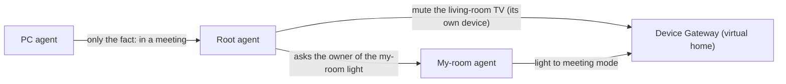
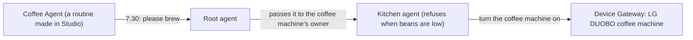

# SWE-Final — Extension of Smart Home: Internal & External Connectivity via A2A

[한국어](README.md) | **English**

**G01 | A2A-Lite** · 고라희, 신윤수, 홍예원 · Hanyang University CSE406 Software Engineering · LG Electronics IC-PBL "Proactive Agentic Home"

Instead of one hub device, **an AI agent in each room** runs the smart home. The agents talk to each other over the
standard **A2A** protocol and connect to agents outside the home, on your PC and phone. New agents are **described in
plain words (Agent Studio) and installed in your home (Agent Hub)**. Everything runs on a virtual home instead of real
devices, and one Docker Compose command starts it all.


> The picture shows the plan from the presentation, so it differs from the repo in places: for example, there is no
> Elderly Room or Google Search agent and no per-agent SLM. See [What is in the repo](#what-is-in-the-repo) for what exists.

## Why

- **One hub does all the work.** Platforms such as Alexa run AI inference, device control and API calls on a single hub
  device. A bigger home makes the hub more expensive and turns it into a bottleneck.
  → Each room gets its own agent that controls only its own devices. A bigger home means more agents, not a bigger hub.
- **The home is cut off from the outside.** Smart-home agents see only in-home devices. They do not know that you are in
  a meeting on your PC or that you left with your phone.
  → The home connects to agents outside over A2A, and the agents you need are made in plain words and installed.

## Two Examples

### 1. "I'm starting a meeting"



1. A person tells the PC agent (`desktop`) that a meeting starts. The PC agent shares only whether a meeting is on
   (`meeting_app_active`); raw personal data such as meeting titles is never sent.
2. The Root agent mutes the living-room TV, its own device, and asks the my-room agent (`room1`), the owner of the
   my-room light, to change the light.
3. The my-room agent decides by its own rules and switches the light to meeting mode. The Device Gateway checks once more
   that the agent sending the command really owns that light.

### 2. Morning Coffee: an Agent Made in Studio



1. In the Studio tab of the Agent Cloud screen, write "brew my coffee every morning at 7:30". Studio makes a Coffee
   Agent, and after a person reviews and approves it, it is registered in the Hub.
2. Connect (install) the Coffee Agent to your home in the Hub. The person approves its one permission ("ask for the
   coffee machine"), and the agent starts right away.
3. At 7:30 the Coffee Agent asks the Root agent, which passes the request to the kitchen agent (`kitchen`), the owner of
   the coffee machine.
4. If the bean sensor says the beans are low, the kitchen agent refuses by its own policy (`SAFETY_POLICY`).

The **Scenario** tab of the screen runs this flow with one button and shows the path of the request from the real records.

## Core Rules

- **Each device has exactly one owning agent.** Agents ask the owner for anyone else's device; even the Root agent only
  passes room devices on to their owner.
- **Room policies apply to every requester.** The protected room refuses to turn off the air conditioner while someone
  sleeps, and the kitchen does not brew without beans.
- **Agents outside the home exchange only the fields they are allowed to.** Raw data such as meeting titles or GPS
  coordinates never leaves the agent.
- **The LLM only interprets words.** Permissions, ownership and policies are decided by the plugin code, and the Device
  Gateway re-checks the owner. In Studio, too, device rules, device ids and tools come from code (the LLM only fills the
  blanks of a fixed form), and a person must approve the agent before it is registered.

## Terms

| Term | Meaning | Where in the repo |
|---|---|---|
| A2A | Google's open protocol for agents to talk to each other. This repo uses v1.0 only | — |
| Agent Card | An agent's business card (JSON): name, address and what it can do. The space, devices and shared fields an agent has are told by `skills[].tags` | `/.well-known/agent-card.json` of each agent |
| Root agent | The home's entry point. It takes requests from people and from agents outside the home and passes them to the device's owner. It owns the living-room devices itself | `agents/internal/root` |
| Room agent | An agent that owns the devices of one space | `agents/internal/room1`, `room2`, `kitchen` |
| External agent | An agent for a device outside the home. It shares only the fields it is allowed to | `agents/external/desktop`, `smartphone` |
| Home A2A messages | The smart-home data carried in an A2A message (`device.control`, `context.query` …) | [spec/home-a2a.md](spec/home-a2a.md) |
| Agent Studio | The service that makes agents from plain words. "Agentic Studio" in the presentation | `services/studio` |
| Agent Hub | The service for accounts, agent registry, search, sharing, connections (installs) and device owners. "Agentic Hub" in the presentation | `services/agenthub` |
| Agent Cloud | The web screen for the Hub and Studio | `web/apps/cloud` |
| Smart home app | The screen with spaces, devices and connected agents. It does not switch devices itself | `web/apps/home` |
| Device Gateway | The virtual home. It keeps the device states and accepts a command only from the device's owner | `services/gateway` |
| Event Collector | Gathers the requests agents send each other and shows the path each request took | `services/collector` |
| OpenClaw | The open-source runtime the agents run on (LLM + tools). Our rules are in the `home-a2a` plugin | `agents/home-a2a-plugin` |

## What Is in the Repo

### Six Platform Agents

| Agent | Name on screen | What it does | Port |
|---|---|---|---|
| `root` | Root 에이전트 (Root agent) | The home's entry point. Owns the living-room light, TV and TV mute; passes everything else to the owner | 19040 |
| `room1` | 내 방 에이전트 (my-room agent) | My-room light, light mode, air conditioner and occupancy. Switches the light to meeting mode when a meeting starts | 19160 |
| `room2` | 보호 방 에이전트 (protected-room agent) | Protected-room light, air conditioner and sleep mode. While someone sleeps, refuses to turn off the AC or turn on the light | 19280 |
| `kitchen` | 주방 에이전트 (kitchen agent) | LG DUOBO coffee machine, bean sensor and kitchen light. Refuses to brew without beans | 18680 |
| `desktop` | PC | Shares whether a meeting is on (`meeting_app_active`) and the PC state (`pc_state`) | 18800 |
| `smartphone` | 스마트폰 (smartphone) | Shares whether the user is home (`presence`) | 18920 |

Studio makes three kinds of agents. Once connected in the Hub, they start in the same container.
- **Room agents** own devices; their rules come from the built-in skills (meeting mode, sleep mode, energy saving …).
- **Routine agents** own no devices and ask the Root agent to control a device at a set time, e.g. the Coffee Agent.
- **Assistant agents** own no devices and only chat, e.g. a workout coach.

### Plan vs. Today

| Plan (presentation) | Today |
|---|---|
| An agent per room, one owner per device | Done: living room (Root), my room, protected room, kitchen |
| Connection to agents outside the home | Done: PC and smartphone. There is no real calendar, Slack or mail integration; you tell the PC agent that a meeting starts. General agents such as Google Search can be registered by their Agent Card URL, but no example exists |
| Kitchen, Elderly Room and Living Room agents | The kitchen agent exists. The Root agent owns the living room itself. There is no Elderly Room; the protected room (`room2`) has the sleep-safety policies |
| Create, modify and delete agents in Studio | Create: done. Delete: in the Hub. Modify: not available (make a new one and delete the old one) |
| Share, search and install in the Hub | Done: accounts, catalog, stars, install counts. There is one home, shared by every account |
| Morning coffee scenario | Done. Reordering beans (an outside purchase) is only a message |
| Per-agent SLMs | Dropped: Claude Haiku (OpenRouter) is used instead. The EXAONE training experiment is kept as a [record](docs/dpo-experiment.md) |
| Cloud deployment (AWS) | Planned only ([deployment plan](docs/presentation/README.md#배포-계획), Korean). Today everything runs locally on Docker Compose |
| Real devices | None: 13 virtual devices in the Device Gateway ([devices.yaml](services/config/devices.yaml)) |

The full list of what each screen and API does is in [docs/FEATURES.md](docs/FEATURES.md) (Korean).

## Run

You need Docker Desktop (10 GB of memory or more: each OpenClaw agent takes about 1 GB) and an
[OpenRouter](https://openrouter.ai) API key. The other tools are listed in [docs/RUN.md](docs/RUN.md#1-필요한-것) (Korean).

```bash
scripts/setup.sh     # once: creates .env and fills the tokens; then add OPENROUTER_API_KEY to .env
scripts/run_all.sh   # docker compose up -d --build, waits until everything is up and prints the addresses
```

Sign up at http://127.0.0.1:3000 and follow the morning coffee in the **Scenario** tab to see everything from making an
agent to a device moving. The first time, the screen tells you to make the Coffee Agent in Studio first.

| Name | Address |
|---|---|
| Agent Cloud (Hub, Studio, Scenario) | http://127.0.0.1:3000 |
| Smart home app | http://127.0.0.1:3001 |
| Agent Hub API · Studio API | http://127.0.0.1:8400/docs · http://127.0.0.1:8500/docs |
| Device Gateway · Event Collector | http://127.0.0.1:8100 · http://127.0.0.1:8200 (needs `DASHBOARD_TOKEN`) |

```bash
scripts/say.sh desktop "나 회의 시작할게"   # talk to an agent ("I'm starting a meeting"; billed by OpenRouter)
scripts/logs.sh                           # watch the messages between agents
scripts/scenario.sh                       # rule checks without an LLM (needs scripts/setup.sh --local)
scripts/test_hub_studio.sh                # 26 Hub and Studio checks
docker compose down                       # stop
```

The demo order, verification scenarios and troubleshooting are in [docs/RUN.md](docs/RUN.md) (Korean).

## Repository Structure

```
SWE-Final/
├── agents/                 the agents (OpenClaw + TypeScript plugin)
│   ├── home-a2a-plugin/    A2A server, permission, ownership and policy rules (core.ts, agent.ts, devices.ts)
│   ├── internal/           inside the home: root, room1, room2, kitchen
│   ├── external/           outside the home: desktop, smartphone
│   └── generated/          agents made in Studio (not in git)
├── services/               Python services (FastAPI)
│   ├── gateway/            Device Gateway: the virtual home, owner checks
│   ├── collector/          Event Collector: request records and flows
│   ├── agenthub/           Agent Hub: accounts, registry, search, sharing, connections, device owners (PostgreSQL)
│   ├── studio/             Agent Studio: words → agent (LangChain + OpenRouter), safety checks
│   └── config/             devices.yaml (virtual devices), agents.yaml (callers), skills.yaml (built-in skills)
├── web/                    the screens (Next.js + shadcn/ui): apps/cloud = Agent Cloud, apps/home = smart home app
├── spec/home-a2a.md        the messages agents exchange
├── scripts/                setup, run and check scripts
├── training/               EXAONE training experiment (record)
├── docs/                   documents and the presentation
├── docker-compose.yml      runs everything
└── plan.md                 the plan (Korean)
```

## Further Reading

| Document | Content |
|---|---|
| [docs/presentation/](docs/presentation/README.md) | The slides (PDF, in English), notes per slide and the deployment plan (notes in Korean) |
| [plan.md](plan.md) | The plan: problems, solution, scenario, scope (Korean) |
| [docs/FEATURES.md](docs/FEATURES.md) | What each screen and API does today (Korean) |
| [docs/RUN.md](docs/RUN.md) | Setup, run, demo order, troubleshooting (Korean) |
| [docs/HANDOFF.md](docs/HANDOFF.md) | Team handoff: decisions and why (Korean) |
| [spec/home-a2a.md](spec/home-a2a.md) | The agent message spec (Korean) |
| [services/README.md](services/README.md) (Korean), [docs/architecture-services.md](docs/architecture-services.md) | Service APIs and architecture |
| [docs/integration.md](docs/integration.md) | Agents with the Gateway and Collector (Korean) |
| [docs/verification-report.md](docs/verification-report.md), [docs/performance.md](docs/performance.md), [docs/dpo-experiment.md](docs/dpo-experiment.md) | Past records: verification results (2026-10-18, from the Home Assistant days), response times, EXAONE training experiment (Korean) |

## Tech Stack

| Area | Technology |
|---|---|
| Agent communication | A2A v1.0 (JSON-RPC), Home A2A messages |
| Agents | OpenClaw, TypeScript plugin |
| LLM | Claude Haiku (OpenRouter); change it with `AGENT_MODEL` for agents and `STUDIO_MODEL` for Studio |
| Services | Python, FastAPI, Pydantic v2, LangChain (Studio) |
| Storage | PostgreSQL (Hub, Studio and Collector), SQLite in tests |
| Screens | Next.js 16, shadcn/ui, Tailwind 4 (Turborepo) |
| Run and CI | Docker Compose, GitHub Actions |
| Testing | pytest, vitest, `node --test`, `scripts/scenario.sh`, `scripts/test_hub_studio.sh` |

## Known Limitations

- There is one home. There are many accounts, but they all share the same virtual home, and an agent another account
  installs moves the same devices. Sign-up is demo-grade (no terms, no e-mail check).
- Virtual device states and subscriptions live only in memory. Restarting the Gateway resets the devices, and when an
  external agent restarts, the agents subscribed to it must restart too.
- The six platform agents take their tokens and addresses from `.env` and `agents/shared.json5`, and peers share the
  tokens (the Hub issues the tokens of Studio agents). Mutually untrusted agents would need per-pair tokens or mTLS.
- The platform agents and Studio room agents each run as one OpenClaw process (about 1 GB). That is why Docker needs
  10 GB or more, and each Studio room agent you connect adds about 1 GB (routine and assistant agents need almost none).

## History

This repo merges SWE26-01's A2A-agents (root) and a2a-agentic-home (`services/`) with their commit history (2026-10-18).
On 2026-11-20 we removed Home Assistant and the old simulator and made everything run from one Docker Compose file.
