# SWE-Final — Extension of Smart Home: Internal & External Connectivity via A2A

[한국어](README.md) | **English**

**G01 | A2A-Lite** · 고라희, 신윤수, 홍예원 (Hanyang University CSE406 · LG Electronics IC-PBL "Proactive Agentic Home")

Today’s smart homes run everything on one hub. We split it into small agents that talk over A2A.
- Inside the home: each room has its own agent for its own devices.
- Outside the home: the home connects to agents on your desktop and phone.
- Agentic Studio: describe an agent in plain words, and it is built for you.
- Agentic Hub: share, find, and install agents.

### 1. Problem Statement


Two problems with today's smart homes:
- **Centralized workload:** platforms such as Amazon Alexa run the whole smart-home workload (AI inference, IoT control, API calls, agentic workflows) on a single hub device. A larger home or higher performance needs more hardware, so the hub gets expensive and becomes the bottleneck (left: One Hub Does Everything). → **We need decentralization.**
- **Lack of External Connection:** AI agent tools such as OpenClaw and Codex keep extending their reach through skills, MCP and APIs, while smart-home agents focus on in-home devices. They are not connected to the desktop (meetings), the phone (home/away), calendar, Slack, mail or other AI agents (right: Closed to the Outside). → **We need a connection to the outside.**

### 2. Background: A2A Protocol

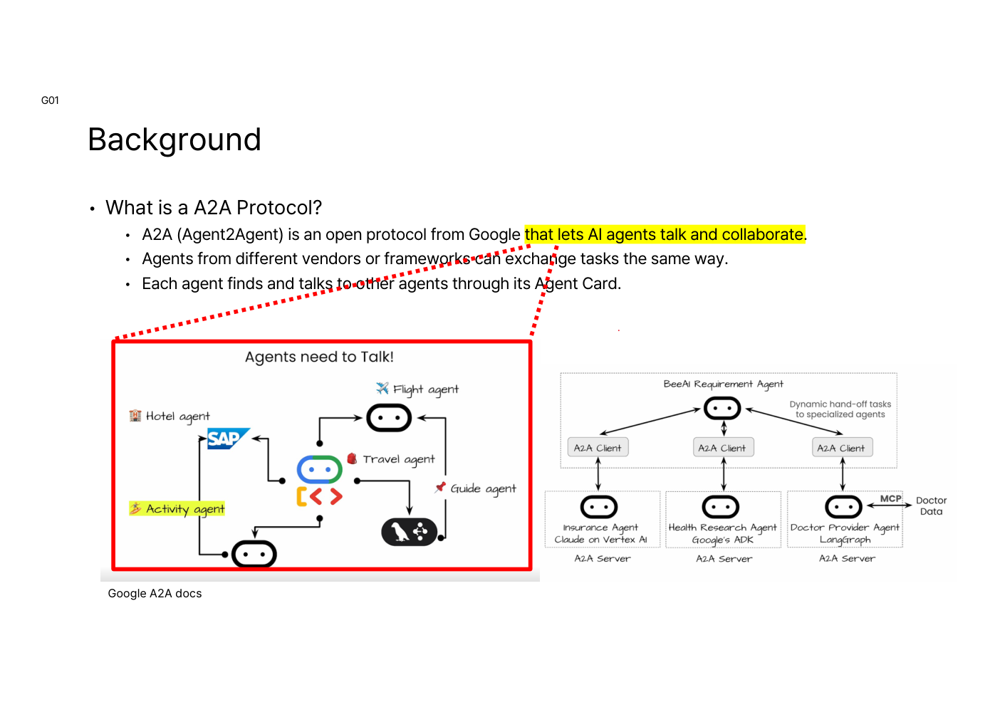

A2A (Agent2Agent) is an open protocol from Google that lets AI agents talk and collaborate. Agents from different vendors or frameworks exchange tasks the same way, and each agent finds others through its **Agent Card**. The left figure (Google A2A docs) shows a travel agent handing work to flight, hotel, activity and guide agents.

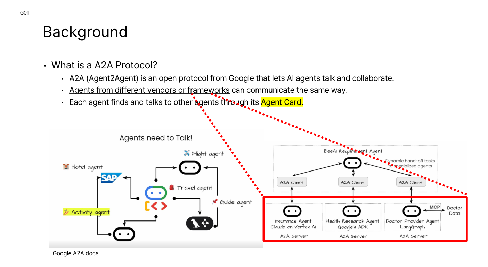

The right figure is highlighted: agents built with **different frameworks** (Claude on Vertex AI, Google ADK, LangGraph) are A2A servers, so one client talks to all of them the same way. This is why we use A2A to connect smart-home agents with agents outside the home.

### 3. Background: How Agents Collaborate

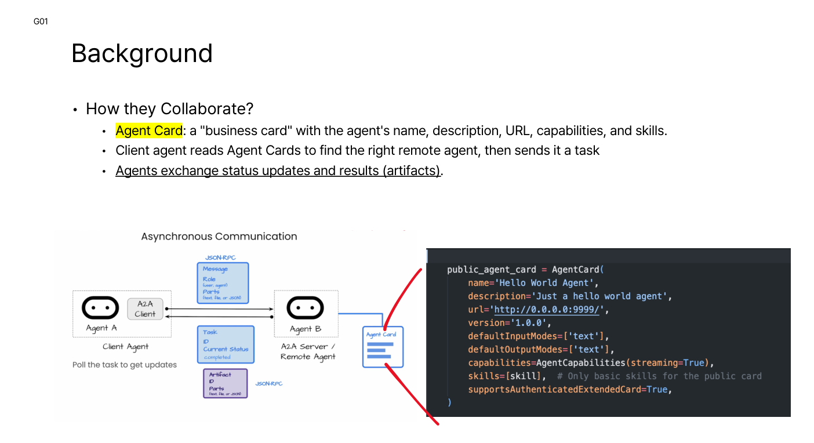

- **Agent Card:** the agent's "business card" with its name, description, URL, capabilities and skills (code on the right).
- A client agent reads Agent Cards to pick the right remote agent, then sends it a task.
- Agents exchange status updates and results (artifacts) over JSON-RPC. For long tasks the client polls the task for progress.

### 4. Problem Statement (Recap)

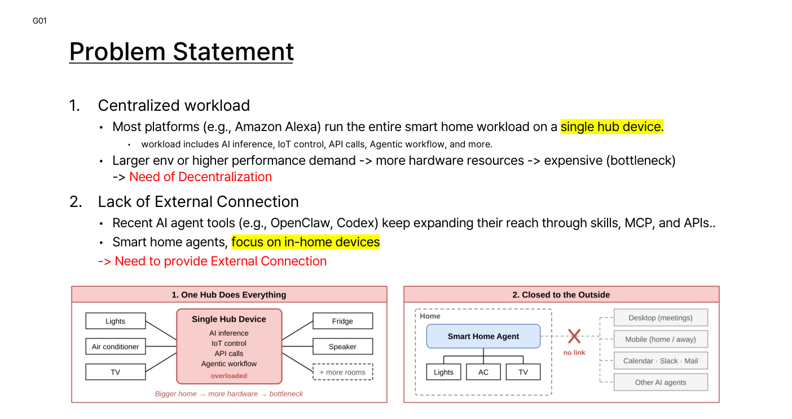

The two problems again before the solution. The following slides answer them with **decentralization (internal extension)** and **a connection to the outside (external extension)**.

### 5. Solution: Internal Extension

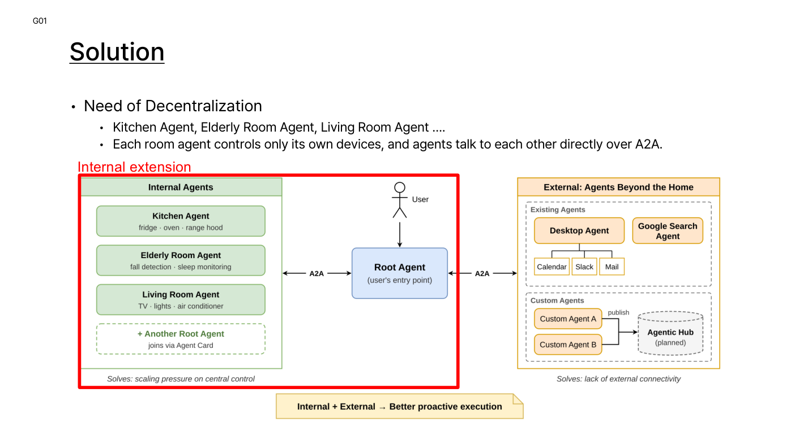

**The answer to decentralization.** Each room gets its own agent: a Kitchen Agent (fridge, oven, range hood), an Elderly Room Agent (fall detection, sleep monitoring), a Living Room Agent (TV, lights, air conditioner). **Each room agent controls only its own devices, and agents talk to each other directly over A2A.** The Root Agent, the user's entry point, only routes a request to the device's owner, and a new room or another Root Agent joins with just its Agent Card. A bigger home means more agents, not a bigger hub.

In this repo: the root (Root) and room1/room2 agents in `agents/`, the ownership and policy rules in [spec/home-a2a.md](spec/home-a2a.md), and the Device Gateway (`services/gateway`), which checks the device owner once more.

### 6. Solution: External Extension — Existing Agents

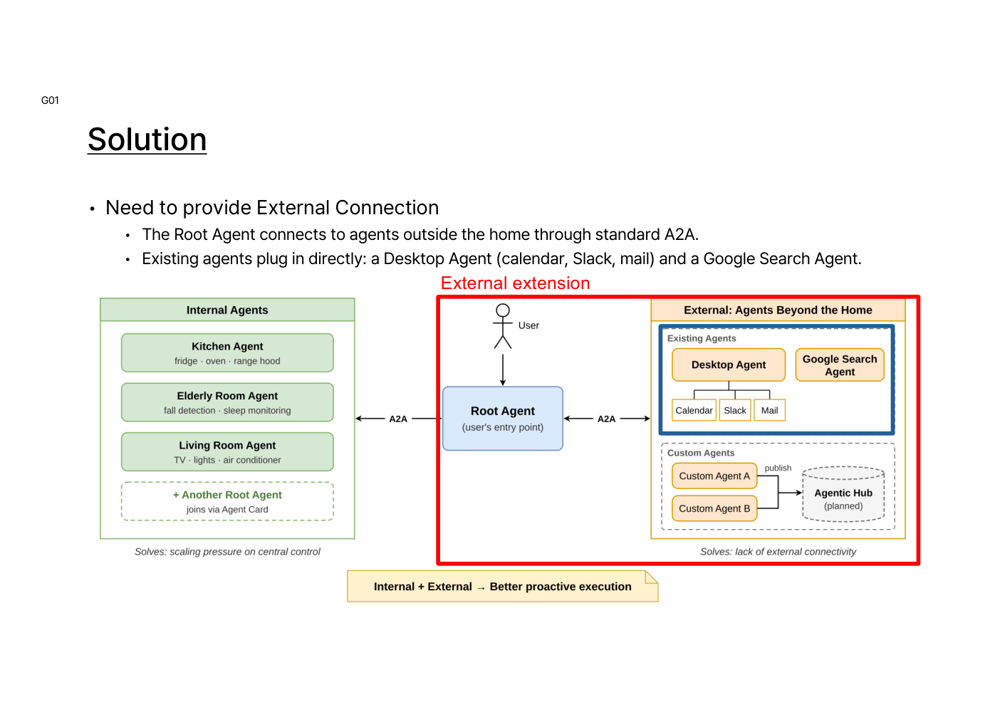

**The answer to external connection (1).** The Root Agent connects to agents outside the home through standard A2A, and existing agents plug in directly: a Desktop Agent (calendar, Slack, mail) and a Google Search Agent. For example, when the Desktop Agent reports "in a meeting", the home switches to a quiet mode. External agents see only the fields they are allowed to; raw personal data such as calendar titles or GPS never leaves the agent.

In this repo: the desktop and smartphone agents in `agents/externel/`.

### 7. Solution: External Extension — Custom Agents

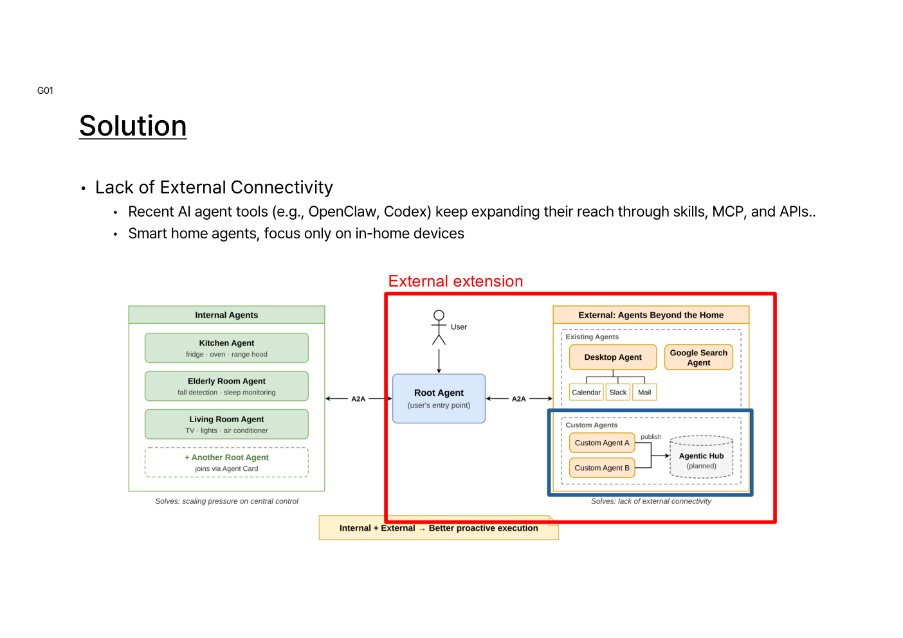

**The answer to external connection (2).** Users build their own Custom Agents and publish them to the **Agentic Hub**. Like MCP servers on GitHub, other users can find and install these agents. With the inside (internal) and the outside (external) connected, the home can act before the user asks (proactive execution).

### 8. Agentic Studio: How to Make Agents

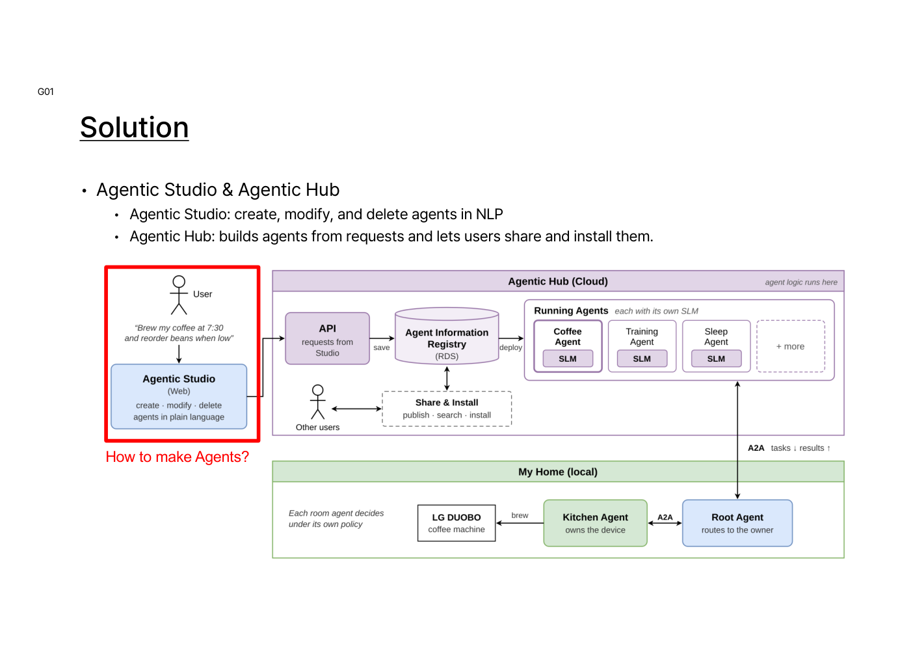

In the web-based **Agentic Studio**, users create, modify and delete agents in natural language. For example, *"Brew my coffee at 7:30 and reorder beans when low"* is sent by Studio to the Agentic Hub API.

In this repo: [services/studio](services/studio). The LLM (LangChain + OpenRouter) only fills a fixed slot form, and the rules come from the platform's built-in skills. An agent is registered in the Hub only after it passes the capability-lock check and the user approves it.

### 9. Agentic Studio: The Agent Card of a Created Agent

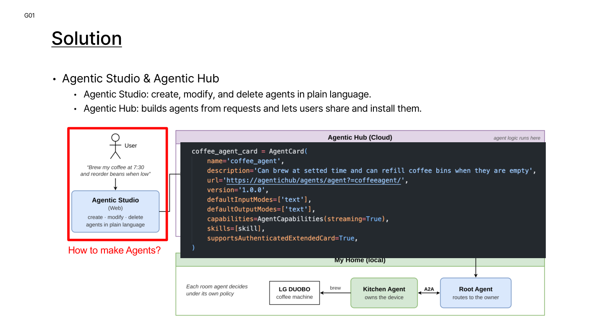

The Coffee Agent made by Studio has a standard A2A Agent Card: name, description ("brews at a set time and refills the coffee bins when they are empty"), its URL in the Hub, capabilities and skills. Other agents find it and send it tasks from this card alone.

### 10. Agentic Hub: How to Serve Agents

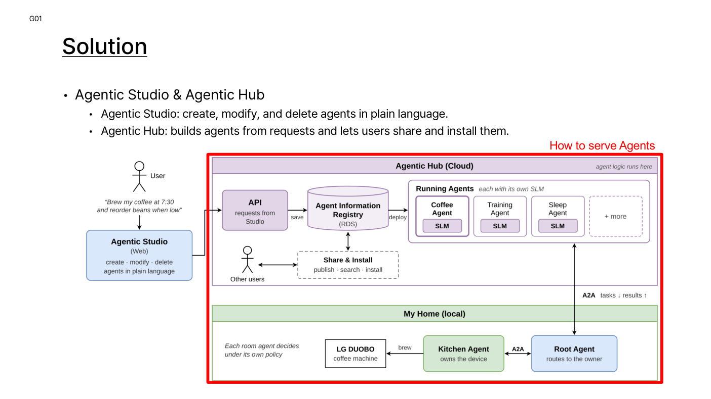

The **Agentic Hub (cloud)** receives Studio's requests through its API, saves them in the Agent Information Registry (RDS) and deploys the agents (Coffee, Training, Sleep …, each with its own SLM). Other users publish, search and install agents through **Share & Install**. A Hub agent sends tasks over A2A to the Root Agent of the user's home, which routes them to the coffee machine's owner, the Kitchen Agent. The Kitchen Agent checks its own policy and runs the LG DUOBO coffee machine. **Each room agent decides under its own policy.**

In this repo: [services/agenthub](services/agenthub) (registry in PostgreSQL on Docker, register/search/connect by Agent Card, one owner per device) and [web/](web/) (the Agent Cloud screen and the smart home app). Generated agents run on OpenClaw today, and `STUDIO_RUNTIME` can switch them to a Python runtime. Sharing and installing between users, cloud deployment and per-agent SLMs are still planned ([plan.md](plan.md#5-구현-범위)).

### 11. Conclusion

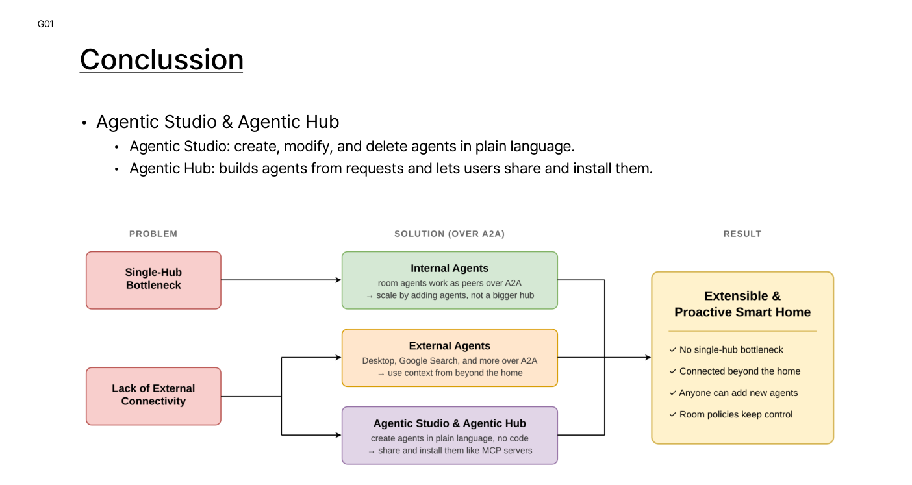

Problem, solution and result on one slide.

| Problem | Solution over A2A | Result |
|---|---|---|
| Single-hub bottleneck | **Internal Agents**: room agents work as peers over A2A; scale by adding agents, not a bigger hub | No single-hub bottleneck |
| Lack of external connectivity | **External Agents**: Desktop, Google Search and more over A2A, using context from beyond the home | Connected beyond the home |
| Lack of external connectivity | **Agentic Studio & Hub**: create agents in plain language with no code; share and install them like MCP servers | Anyone can add new agents |

Whoever sends a request, **room policies keep control**. The result is an extensible and proactive smart home.

## Tech Stack

| Area | Technology |
|---|---|
| Agent communication | A2A v1.0, Home A2A extension ([spec/home-a2a.md](spec/home-a2a.md)) |
| Agents | OpenClaw + TypeScript plugin (swappable for a Python runtime with `STUDIO_RUNTIME`) |
| Backend | Python, FastAPI, Pydantic v2 |
| Agent creation (Studio) | LangChain structured output, OpenRouter |
| Storage | PostgreSQL (Hub, Studio and Collector, Docker / RDS), SQLite (tests) |
| Screen | Next.js (Agent Hub) |
| Run and deploy | Docker Compose (local), AWS ECS Fargate (planned), GitHub Actions |
| Testing | pytest, vitest, `scripts/scenario.sh`, `scripts/test_hub_studio.sh` |

### Deployment Structure

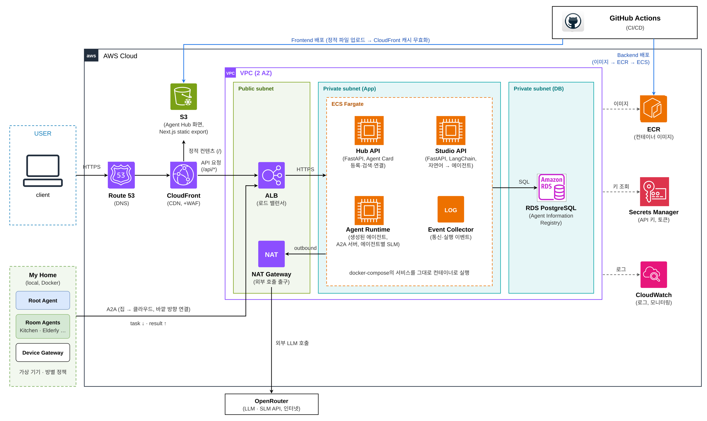

The planned deployment of the Agentic Hub on AWS. Today the repo runs the same services locally with Docker Compose.
- **Screen and API entry:** users come in through Route 53 → CloudFront (+WAF). Static content (`/`) is the Agent Hub screen on S3 (Next.js static export); API requests (`/api/*`) go through the ALB to the services.
- **Services (ECS Fargate, private subnet):** Hub API, Studio API, Agent Runtime (generated agents' A2A servers, per-agent SLMs) and Event Collector, run as containers straight from the `docker-compose.yml` services.
- **Data:** the Agent Information Registry is RDS PostgreSQL in a private DB subnet. API keys and tokens live in Secrets Manager, logs in CloudWatch, images in ECR.
- **Outbound calls:** LLM and SLM calls (OpenRouter) go out through the NAT Gateway.
- **The home (My Home, local Docker):** the Root Agent, room agents and Device Gateway (virtual devices, per-room policies) stay at home. The home opens the A2A connection to the cloud, receives tasks (task ↓) and returns results (result ↑).
- **CI/CD (GitHub Actions):** the screen is uploaded to S3 followed by a CloudFront cache invalidation; the backend image is pushed to ECR and deployed to ECS.

## Repository Structure

```
SWE-Final/
├── docker-compose.yml        # run everything: docker compose up -d --build
├── plan.md                   # plan (from the presentation, Korean)
├── agents/                   # five OpenClaw agents + the Home A2A plugin (TypeScript)
│   ├── home-a2a-plugin/   #   ACL, ownership, policy (core.ts); inbound, delegation, rules (agent.ts); Gateway client (devices.ts)
│   ├── externel/             #   desktop, smartphone (agents outside the home)
│   ├── internel/             #   root (Root), room1, room2, kitchen (agents inside the home)
│   ├── generated/            #   agents made in Studio (not in git)
│   └── Dockerfile            #   runs the five agents and the Studio agent launcher (scripts/launcher.mjs) in one container
├── services/                 # Python (FastAPI)
│   ├── gateway/              #   Device Gateway: the virtual home's device states + owner check
│   ├── collector/            #   Event Collector: every agent's messages and actions, request flows
│   ├── agenthub/             #   Agent Hub: registry, search, connections, tokens, device owners (PostgreSQL)
│   ├── studio/               #   Agent Studio: plain language → agent (LangChain + OpenRouter), harness, runtime (runtime.py)
│   ├── config/               #   agents.yaml (callers), devices.yaml (virtual devices), skills.yaml (built-in skills)
│   └── contracts/            #   message formats for screens (JSON Schema)
├── web/                      # the screens (shadcn/ui monorepo): apps/cloud = Agent Cloud (:3000), apps/home = smart home app (:3001), packages/ui and core; tokens stay in their server-side proxy
├── spec/                     # Home A2A extension spec
├── scripts/                  # setup.sh, run_all.sh, scenario.sh, say.sh, logs.sh, test_hub_studio.sh, oc.sh, launcher.mjs
├── training/                 # EXAONE SFT/DPO experiments (basis for per-agent SLMs)
└── docs/                     # presentation, run guide, handoff, architecture, verification and performance records
```

| Document | Content |
|---|---|
| [docs/RUN.md](docs/RUN.md) | From setup to demo (Korean) |
| [docs/HANDOFF.md](docs/HANDOFF.md) | Project context and decisions (Korean) |
| [docs/integration.md](docs/integration.md) | Agents with the Gateway and Collector (Korean) |
| [docs/architecture-services.md](docs/architecture-services.md) | Services architecture |
| [services/README.md](services/README.md) | Hub and Studio APIs, harness (Korean) |
| [docs/verification-report.md](docs/verification-report.md), [docs/performance.md](docs/performance.md), [docs/dpo-experiment.md](docs/dpo-experiment.md) | Verification results, response times, EXAONE training experiment (records, Korean) |

This repo merges SWE26-01's A2A-agents (root) and a2a-agentic-home (`services/`) with their commit history. On 2026-11-20 we removed Home Assistant, the old simulator screen and the Live Simulation Runner, and made everything run from one Docker Compose file.

## Agents

Five OpenClaw agents talk to each other over A2A v1.0 with the **Home A2A extension** ([spec/home-a2a.md](spec/home-a2a.md)), which adds context sharing and subscription, per-space ownership and policy-aware collaboration.

| Agent | Role in the presentation | Port | Shared context / owned devices |
|---|---|---|---|
| `externel/desktop` | External: Desktop Agent | 18800 | `meeting_app_active`, `pc_state` |
| `externel/smartphone` | External: phone | 18920 | `presence` |
| `internel/root` | Root Agent (user's entry point) | 19040 | living-room light, TV, TV mute |
| `internel/room1` | Internal: room agent (My Room) | 19160 | my-room light, light mode, air conditioner, occupancy |
| `internel/room2` | Internal: room agent (sleep-policy room) | 19280 | protected-room light, air conditioner, sleep mode |

```
desktop ──"meeting starts"──▶ root ──(checks requester ACL)──▶ room1 (accepts/refuses by its own rules) ──▶ Device Gateway (re-checks owner)
   ▲                              │
   └────── context.query ─────────┘   (Root reads external context; only allowed fields come back)
```

The LLM (OpenClaw) only interprets the user's intent and calls `a2a_*` tools. Policy, ownership and freshness are decided deterministically by the plugin code, and a device moves only after the Device Gateway checks its owner once more. There is no real hardware: the Gateway holds the virtual home (`services/config/devices.yaml`).

## Run

```bash
scripts/setup.sh               # once: creates .env and fills the tokens; then add OPENROUTER_API_KEY to .env
docker compose up -d --build   # or scripts/run_all.sh (waits until everything is up and prints the addresses)
```

| Name | Address |
|---|---|
| Agent Cloud screen | http://127.0.0.1:3000 |
| Smart home app (spaces, devices, external connections) | http://127.0.0.1:3001 |
| Agent Hub API · Studio API | http://127.0.0.1:8400/docs · http://127.0.0.1:8500/docs |
| Device Gateway · Event Collector | http://127.0.0.1:8100 · http://127.0.0.1:8200 (`DASHBOARD_TOKEN`) |
| Agents | 127.0.0.1:18800 / 18920 / 19040 / 19160 / 19280 |

```bash
scripts/logs.sh                                  # A2A event log
scripts/say.sh desktop "나 회의 시작할게"           # one natural-language turn ("I'm starting a meeting")
scripts/scenario.sh [--llm] [--kill-home]        # deterministic checks (needs scripts/setup.sh --local)
scripts/test_hub_studio.sh                       # 26 Hub and Studio checks
docker compose down                              # stop
```

Step-by-step instructions and troubleshooting: [docs/RUN.md](docs/RUN.md) (Korean).

## Verification (plan.md 5.3)
| Item | Scenario |
|---|---|
| External context reaches the home | subscription → `context.update` → room1 light switches to meeting mode |
| Disallowed queries are blocked | Root queries `pc_state` → `FIELD_NOT_ALLOWED`; a wrong token → `UNAUTHORIZED` |
| Stale or out-of-order data is ignored | older sequence or expired data → `STALE` |
| Agents control only their own devices | room1 controls the living-room TV → `NOT_OWNER`; Root delegates room devices (`delegated_to`); the Gateway also refuses commands on another agent's device (403) |
| Safety policies refuse requests | turning off the AC in room2 while asleep → `SAFETY_POLICY` |
| Rooms work without Root | `--kill-home` |
| Whole-home collaboration | energy saving → room1 complies, room2 partly refuses → Root aggregates `PARTIAL` |
| New agents join | the Hub refuses a connection that would give a device a second owner and starts a connected Studio agent; Root and the Gateway follow the Hub's current owners |
| Agents from natural language | agents made in Studio are registered in the Hub only after the capability-lock check and user approval |

## Known Limitations
- Each agent has one token, shared with its peers. For mutually untrusted agents, switch to per-pair tokens or mTLS.
- The virtual home's device states live in the Gateway's memory; restarting the Gateway resets them.
- Subscriptions live only in the publisher's memory. When an external agent restarts, its subscribers must restart too.
- One OpenClaw gateway uses about 1 GB of memory (the LLM is OpenRouter, not local). The six platform agents need Docker Desktop memory set to 10 GB or more. Assistant and routine agents run inside the launcher without OpenClaw.
- The five platform agents still take their tokens and addresses from `.env` and `agents/shared.json5`; the Hub decides connections and owners on top.
- There are many accounts but one home: an agent another account installs (connects) moves the same virtual home's devices. Sign-up is demo-grade (no terms, no e-mail check).
