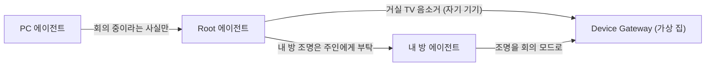
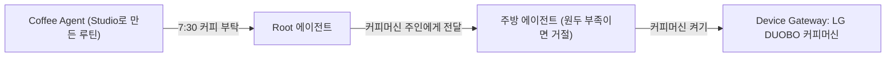

# SWE-Final — Extension of Smart Home: Internal & External Connectivity via A2A

**한국어** | [English](README.en.md)

**G01 | A2A-Lite** · 고라희, 신윤수, 홍예원 · 한양대 CSE406 소프트웨어공학 · LG전자 IC-PBL "Proactive Agentic Home"

스마트홈을 허브 기기 하나가 아니라 **방마다 있는 AI 에이전트**가 나눠 맡는다. 에이전트끼리는 표준 프로토콜
**A2A**로 대화하고, 집 밖의 PC·스마트폰 에이전트와도 연결된다. 새 에이전트는 **말로 만들고(Agent Studio)
우리 집에 설치한다(Agent Hub)**. 실제 기기 대신 가상 집에서 돌아가고, Docker Compose 한 번으로 전부 뜬다.


> 그림은 발표(기획) 기준이라 지금 레포와 다른 곳이 있다. 예를 들어 Elderly Room·Google Search 에이전트와
> 에이전트별 SLM은 레포에 없다. 실제 구성은 [지금 레포에 있는 것](#지금-레포에-있는-것)을 본다.

## 왜 만들었나

- **허브 하나에 일이 몰린다.** Alexa 같은 플랫폼은 AI 추론, 기기 제어, API 호출을 허브 기기 하나가 모두 처리한다.
  집이 커지면 허브가 비싸지고 병목이 된다.
  → 방마다 에이전트를 두고 각자 자기 기기만 맡긴다. 집이 커지면 허브를 키우는 대신 에이전트를 더한다.
- **집 밖과 끊겨 있다.** 스마트홈 에이전트는 집 안 기기만 본다. 내가 PC로 회의 중인지, 휴대폰을 들고 나갔는지 모른다.
  → 집 밖 에이전트와 A2A로 연결하고, 필요한 에이전트는 말로 만들어 설치한다.

## 예시로 보기

### 1. "나 회의 시작할게"



1. 사람이 PC 에이전트(`desktop`)에게 회의를 시작한다고 말한다. PC 에이전트는 회의 중인지(`meeting_app_active`)만
   알린다. 일정 제목 같은 원본 개인정보는 보내지 않는다.
2. Root 에이전트는 자기 기기인 거실 TV를 음소거하고, 내 방 조명은 그 조명의 주인인 내 방 에이전트(`room1`)에게 부탁한다.
3. 내 방 에이전트가 자기 규칙으로 판단해 조명을 회의 모드로 바꾼다. Device Gateway는 명령을 보낸 에이전트가
   정말 그 조명의 주인인지 한 번 더 확인한다.

### 2. 아침 커피: Studio로 만든 에이전트



1. Agent Cloud 화면의 Studio 탭에 "매일 아침 7시 반에 커피 내려 줘"라고 쓴다. Studio가 Coffee Agent를 만들고,
   사람이 내용을 확인해 승인하면 Hub에 등록된다.
2. Hub에서 Coffee Agent를 우리 집에 연결(설치)한다. 이때 사람이 "커피머신 제어 요청" 권한을 승인하고, 연결하면 바로 실행된다.
3. 7:30에 Coffee Agent가 Root에게 부탁하고, Root는 커피머신의 주인인 주방 에이전트(`kitchen`)에게 넘긴다.
4. 원두 부족 센서가 켜져 있으면 주방 에이전트가 자기 정책으로 거절한다(`SAFETY_POLICY`).

화면의 **시나리오** 탭에서 이 흐름을 버튼 하나로 돌려 보고, 요청이 지나간 경로를 실제 기록으로 확인할 수 있다.

## 핵심 규칙

- **기기마다 주인 에이전트는 하나다.** 남의 기기는 주인에게 부탁한다. Root도 방 기기는 주인에게 넘기기만 한다.
- **방 정책은 누가 요청하든 적용된다.** 보호 방은 수면 중 에어컨 끄기를 거절하고, 주방은 원두가 없으면 커피를 내리지 않는다.
- **집 밖 에이전트와는 허용된 정보만 주고받는다.** 일정 제목, GPS 좌표 같은 원본은 에이전트 밖으로 나가지 않는다.
- **LLM은 말을 해석할 뿐이다.** 권한·소유권·정책은 플러그인 코드가 판단하고, Device Gateway가 주인을 다시 확인한다.
  Studio에서도 기기 규칙·기기 id·도구는 코드가 만들고(LLM은 정해진 양식의 빈칸만 채운다), 사람이 승인해야 등록된다.

## 용어

| 용어 | 뜻 | 레포 위치 |
|---|---|---|
| A2A | Google이 공개한 에이전트 간 통신 프로토콜. 이 레포는 v1.0만 쓴다 | — |
| Agent Card | 에이전트의 명함(JSON). 이름, 주소, 할 수 있는 일을 담는다. 맡은 공간·기기·공유 정보는 `skills[].tags`로 알린다 | 각 에이전트의 `/.well-known/agent-card.json` |
| Root 에이전트 | 집의 입구. 사람과 집 밖 에이전트의 요청을 받아 기기 주인에게 넘긴다. 거실 기기는 직접 맡는다 | `agents/internal/root` |
| 방 에이전트 | 한 공간의 기기를 맡는 에이전트 | `agents/internal/room1`, `room2`, `kitchen` |
| 외부 에이전트 | 집 밖 기기의 에이전트. 허용된 정보만 알려 준다 | `agents/external/desktop`, `smartphone` |
| Home A2A 메시지 | A2A 메시지에 담는 스마트홈용 데이터 형식(`device.control`, `context.query` 등) | [spec/home-a2a.md](spec/home-a2a.md) |
| Agent Studio | 말로 에이전트를 만드는 서비스. 발표의 "Agentic Studio" | `services/studio` |
| Agent Hub | 계정, 에이전트 등록·검색·공유·연결(설치), 기기 주인을 관리하는 서비스. 발표의 "Agentic Hub" | `services/agenthub` |
| Agent Cloud | Hub와 Studio를 쓰는 웹 화면 | `web/apps/cloud` |
| 스마트홈 앱 | 공간·기기·연결된 에이전트를 보는 화면. 기기를 직접 켜고 끄지는 않는다 | `web/apps/home` |
| Device Gateway | 가상 집. 기기 상태를 들고 있고, 그 기기의 주인 에이전트가 보낸 명령만 받는다 | `services/gateway` |
| Event Collector | 에이전트들이 주고받은 요청을 모아, 요청 하나가 지나간 경로로 보여 준다 | `services/collector` |
| OpenClaw | 에이전트를 돌리는 오픈소스 런타임(LLM + 도구). 우리 규칙은 `home-a2a` 플러그인에 있다 | `agents/home-a2a-plugin` |

## 지금 레포에 있는 것

### 기본 에이전트 6개

| 에이전트 | 화면 이름 | 하는 일 | 포트 |
|---|---|---|---|
| `root` | Root 에이전트 | 집의 입구. 거실 조명·TV·TV 음소거를 맡고, 나머지는 주인에게 넘긴다 | 19040 |
| `room1` | 내 방 에이전트 | 내 방 조명·조명 모드·에어컨·재실. 회의가 시작되면 조명을 회의 모드로 바꾼다 | 19160 |
| `room2` | 보호 방 에이전트 | 보호 방 조명·에어컨·수면 모드. 수면 중에는 에어컨 끄기와 조명 켜기를 거절한다 | 19280 |
| `kitchen` | 주방 에이전트 | LG DUOBO 커피머신·원두 부족 센서·주방 조명. 원두가 없으면 커피를 거절한다 | 18680 |
| `desktop` | PC | 회의 중인지(`meeting_app_active`)와 PC 상태(`pc_state`)를 알린다 | 18800 |
| `smartphone` | 스마트폰 | 집에 있는지(`presence`)를 알린다 | 18920 |

Studio가 만드는 에이전트는 세 종류다. Hub에서 연결하면 같은 컨테이너에서 추가로 뜬다.
- **방 에이전트**: 기기를 맡고, 기본 스킬(회의 모드, 수면 모드, 절전 등)로 규칙을 만든다.
- **루틴 에이전트**: 기기 없이 정한 시각에 Root에게 기기 제어를 부탁한다. 예: Coffee Agent.
- **대화형 에이전트**: 기기 없이 대화만 한다. 예: 운동 코치.

### 기획과 비교

| 기획(발표) | 지금 |
|---|---|
| 방마다 에이전트, 기기마다 주인 하나 | 됨. 거실(Root)·내 방·보호 방·주방 |
| 집 밖 에이전트 연결 | 됨. PC·스마트폰. 실제 캘린더·Slack·메일 연동은 없고, 회의 여부는 PC 에이전트에게 말해서 정한다. Google Search 같은 범용 에이전트는 Agent Card 주소로 등록만 할 수 있고 예시는 없다 |
| Kitchen·Elderly Room·Living Room 에이전트 | 주방 에이전트는 있다. 거실은 Root가 직접 맡는다. Elderly Room은 없고, 수면 중 보호 정책이 있는 보호 방(`room2`)이 있다 |
| Studio로 만들기·고치기·지우기 | 만들기는 됨. 지우기는 Hub에서 한다. 고치기는 없다(새로 만들고 이전 것을 지운다) |
| Hub 공유·검색·설치 | 됨. 계정, 카탈로그, 별, 설치 수. 집은 하나라 모든 계정이 같은 가상 집을 쓴다 |
| 아침 커피 시나리오 | 됨. 원두 재주문(외부 구매)은 안내 문구만 보여 준다 |
| 에이전트별 SLM | 안 한다. Claude Haiku(OpenRouter) 호출로 대신한다. EXAONE 학습 실험은 [기록](docs/dpo-experiment.md)으로만 남겼다 |
| 클라우드 배포(AWS) | 계획만 있다([배포 계획](docs/presentation/README.md#배포-계획)). 지금은 로컬 Docker Compose로 돈다 |
| 실제 기기 | 없다. Device Gateway의 가상 기기 13개([devices.yaml](services/config/devices.yaml)) |

화면·API별로 되는 기능의 전체 목록은 [docs/FEATURES.md](docs/FEATURES.md)에 있다.

## 실행

Docker Desktop(메모리 10GB 이상: OpenClaw 에이전트 하나가 약 1GB)과 [OpenRouter](https://openrouter.ai) API 키가 필요하다.
나머지 도구는 [docs/RUN.md](docs/RUN.md#1-필요한-것)에 있다.

```bash
scripts/setup.sh     # 처음 한 번: .env를 만들고 토큰을 채운다. 그다음 .env에 OPENROUTER_API_KEY를 넣는다
scripts/run_all.sh   # docker compose up -d --build 후 전부 뜰 때까지 기다리고 주소를 출력한다
```

http://127.0.0.1:3000 에서 회원가입한 뒤 **시나리오** 탭의 아침 커피를 따라가면, 에이전트를 만드는 것부터 기기가
움직이는 것까지 한 번에 보인다. 처음이면 화면 안내대로 Studio에서 Coffee Agent부터 만든다.

| 이름 | 주소 |
|---|---|
| Agent Cloud (Hub·Studio·시나리오) | http://127.0.0.1:3000 |
| 스마트홈 앱 | http://127.0.0.1:3001 |
| Agent Hub API · Studio API | http://127.0.0.1:8400/docs · http://127.0.0.1:8500/docs |
| Device Gateway · Event Collector | http://127.0.0.1:8100 · http://127.0.0.1:8200 (`DASHBOARD_TOKEN` 필요) |

```bash
scripts/say.sh desktop "나 회의 시작할게"   # 에이전트에게 말하기 (OpenRouter 과금)
scripts/logs.sh                           # 에이전트끼리 주고받는 메시지 보기
scripts/scenario.sh                       # LLM 없이 규칙 검증 (scripts/setup.sh --local 필요)
scripts/test_hub_studio.sh                # Hub·Studio 26단계 확인
docker compose down                       # 끄기
```

데모 순서, 검증 시나리오, 문제 해결은 [docs/RUN.md](docs/RUN.md)에 있다.

## 레포 구조

```
SWE-Final/
├── agents/                 에이전트 (OpenClaw + TypeScript 플러그인)
│   ├── home-a2a-plugin/    A2A 서버, 권한·소유권·정책 규칙 (core.ts, agent.ts, devices.ts)
│   ├── internal/           집 안: root, room1, room2, kitchen
│   ├── external/           집 밖: desktop, smartphone
│   └── generated/          Studio가 만든 에이전트 (git에 올리지 않음)
├── services/               Python 서비스 (FastAPI)
│   ├── gateway/            Device Gateway: 가상 집, 기기 주인 확인
│   ├── collector/          Event Collector: 요청 기록과 흐름
│   ├── agenthub/           Agent Hub: 계정, 등록·검색·공유·연결, 기기 주인 (PostgreSQL)
│   ├── studio/             Agent Studio: 말 → 에이전트 (LangChain + OpenRouter), 안전 검사
│   └── config/             devices.yaml(가상 기기), agents.yaml(호출자), skills.yaml(기본 스킬)
├── web/                    화면 (Next.js + shadcn/ui): apps/cloud = Agent Cloud, apps/home = 스마트홈 앱
├── spec/home-a2a.md        에이전트끼리 주고받는 메시지 형식
├── scripts/                설치·실행·검증 스크립트
├── training/               EXAONE 학습 실험 (기록)
├── docs/                   문서와 발표 자료
├── docker-compose.yml      전체 실행
└── plan.md                 기획서
```

## 더 읽을 문서

| 문서 | 내용 |
|---|---|
| [docs/presentation/](docs/presentation/README.md) | 발표 자료(PDF), 슬라이드별 설명, 배포 계획 그림 |
| [plan.md](plan.md) | 기획서: 문제, 해결, 시나리오, 구현 범위 |
| [docs/FEATURES.md](docs/FEATURES.md) | 화면·API별로 지금 되는 기능 |
| [docs/RUN.md](docs/RUN.md) | 설치, 실행, 데모 순서, 문제 해결 |
| [docs/HANDOFF.md](docs/HANDOFF.md) | 팀 인수인계: 정한 것과 그 이유 |
| [spec/home-a2a.md](spec/home-a2a.md) | 에이전트 메시지 명세 |
| [services/README.md](services/README.md), [docs/architecture-services.md](docs/architecture-services.md) | 서비스 API와 구조 |
| [docs/integration.md](docs/integration.md) | 에이전트와 Gateway·Collector 연동 |
| [docs/verification-report.md](docs/verification-report.md), [docs/performance.md](docs/performance.md), [docs/dpo-experiment.md](docs/dpo-experiment.md) | 지난 기록: 검증 결과(2026-10-18, Home Assistant를 쓰던 때), 응답 속도, EXAONE 학습 실험 |

## 기술 스택

| 영역 | 기술 |
|---|---|
| 에이전트 통신 | A2A v1.0 (JSON-RPC), Home A2A 메시지 |
| 에이전트 | OpenClaw, TypeScript 플러그인 |
| LLM | Claude Haiku (OpenRouter). 에이전트는 `AGENT_MODEL`, Studio는 `STUDIO_MODEL`로 바꾼다 |
| 서비스 | Python, FastAPI, Pydantic v2, LangChain (Studio) |
| 저장소 | PostgreSQL (Hub·Studio·Collector), 테스트는 SQLite |
| 화면 | Next.js 16, shadcn/ui, Tailwind 4 (Turborepo) |
| 실행·CI | Docker Compose, GitHub Actions |
| 테스트 | pytest, vitest, `node --test`, `scripts/scenario.sh`, `scripts/test_hub_studio.sh` |

## 알려진 한계

- 집은 하나다. 계정은 여럿이지만 모든 계정이 같은 가상 집을 쓰고, 다른 계정이 설치한 에이전트도 같은 기기를 움직인다.
  회원가입은 약관·이메일 확인이 없는 데모 수준이다.
- 가상 기기 상태와 구독 정보는 메모리에만 있다. Gateway를 다시 시작하면 기기가 처음 상태로 돌아가고,
  외부 에이전트를 다시 시작하면 구독하던 에이전트도 다시 시작해야 한다.
- 기본 에이전트 6개의 토큰과 주소는 `.env`와 `agents/shared.json5`에 고정되어 있고, 토큰을 피어끼리 공유한다
  (Studio 에이전트의 토큰은 Hub가 발급한다). 서로 믿지 않는 에이전트끼리라면 쌍별 토큰이나 mTLS가 필요하다.
- 기본 에이전트와 Studio 방 에이전트는 각각 OpenClaw 프로세스 하나(약 1GB)로 돈다. 그래서 Docker 메모리가
  10GB 이상 필요하고, Studio 방 에이전트를 연결할 때마다 1GB씩 더 든다(루틴·대화형 에이전트는 거의 들지 않는다).

## 레포 이력

SWE26-01의 A2A-agents(루트)와 a2a-agentic-home(`services/`)을 커밋 기록째 합친 레포다(2026-10-18).
2026-11-20에 Home Assistant와 예전 시뮬레이터를 지우고 Docker Compose 하나로 실행하도록 정리했다.
