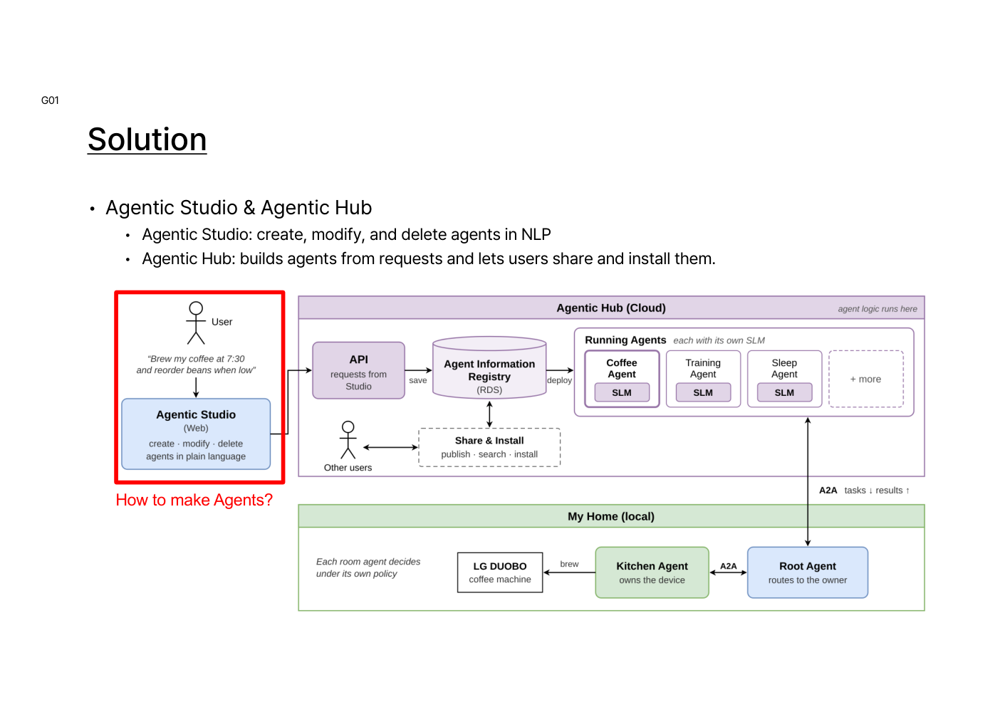
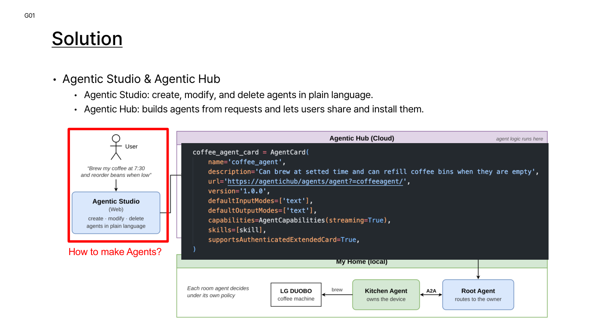

# SWE-Final — Extension of Smart Home: Internal & External Connectivity via A2A

**G01 | A2A-Lite** · 고라희, 신윤수, 홍예원 (한양대 CSE406 · LG전자 IC-PBL "Proactive Agentic Home")

허브 하나가 모든 일을 하는 스마트홈을 A2A로 나눈다. 집 안은 방마다 독립된 에이전트가 자기 기기와 정책을 맡고(Internal extension), 집 밖의 데스크톱·휴대폰·사용자가 만든 에이전트와도 A2A로 연결한다(External extension). 사용자는 Agentic Studio에서 평범한 말로 에이전트를 만들고, Agentic Hub에서 등록·검색·연결한다. 기획서: [plan.md](plan.md)

### 1. Problem Statement


스마트홈의 두 가지 문제를 정의한다.
- **Single Hub bottleneck:** Alexa 같은 플랫폼은 AI 추론, IoT 제어, API 호출, 에이전트 워크플로를 모두 허브 기기 하나에서 처리한다. 집이 커지면 더 비싼 하드웨어가 필요하고 허브가 병목이 된다. → 분산이 필요하다.
- **Lack of External Connectivity:** OpenClaw, Codex 같은 AI 에이전트 도구는 Skill·MCP·API로 연결을 넓히는데, 스마트홈 에이전트는 집 안 기기만 본다. 데스크톱(회의), 휴대폰(재실/외출), 캘린더·Slack·메일과 연결되지 않는다. → 집 밖과의 연결이 필요하다.

### 2. Background: A2A Protocol


A2A(Agent2Agent)는 Google이 공개한 개방형 프로토콜로, AI 에이전트끼리 대화하고 협업하게 한다. 왼쪽 그림(Google A2A 문서)처럼 Travel 에이전트가 Flight·Hotel·Activity·Guide 에이전트에게 일을 나눠 맡긴다. 각 에이전트는 Agent Card로 서로를 찾는다.


같은 슬라이드에서 오른쪽을 강조했다. Vertex AI 위의 Claude, Google ADK, LangGraph처럼 **서로 다른 프레임워크로 만든 에이전트**도 A2A Server로 열려 있으면 하나의 Client가 같은 방식으로 작업을 보낸다. 스마트홈 에이전트와 집 밖 에이전트를 잇는 데 A2A를 쓰는 이유다.

### 3. Background: 에이전트가 협업하는 방식


- **Agent Card:** 에이전트의 "명함". 이름, 설명, URL, capabilities, skills를 담는다(오른쪽 코드).
- Client 에이전트는 Agent Card를 읽고 알맞은 Remote 에이전트를 골라 작업(Task)을 보낸다.
- 에이전트들은 JSON-RPC로 상태 업데이트와 결과(Artifact)를 주고받는다. 오래 걸리는 작업은 Task를 조회해 진행 상황을 받는다.

### 4. Problem Statement (다시)


해결책으로 넘어가기 전에 두 문제를 다시 짚는다. 왼쪽 그림은 허브 하나가 모든 기기를 떠안는 구조(One Hub Does Everything), 오른쪽은 스마트홈 에이전트가 데스크톱·휴대폰·캘린더·다른 에이전트와 끊겨 있는 구조(Closed to the Outside)다.

### 5. Solution: Internal extension


허브 병목에 대한 해결책이다. Kitchen(냉장고·오븐·후드), Elderly Room(낙상 감지·수면 모니터링), Living Room(TV·조명·에어컨)처럼 **방마다 에이전트를 두고**, 각자 자기 기기의 주인으로서 자기 정책에 따라 판단한다. 사용자의 입구인 Root Agent는 요청을 기기 주인에게 전달만 한다. 새 방이나 다른 Root Agent도 Agent Card만 있으면 합류한다.

레포에서는 `agents/`의 orchestrator(Root)와 room1·room2(방), 그리고 [spec/ambient-a2a.md](spec/ambient-a2a.md)의 소유권·정책 규칙이 이 부분이다.

### 6. Solution: External extension — 기존 에이전트


집 밖과의 연결에 대한 해결책이다. 이미 있는 외부 에이전트를 Root Agent와 A2A로 잇는다. Desktop Agent는 캘린더·Slack·메일을 보고 "회의 중" 같은 상태를 알려 주고, Google Search Agent 같은 범용 에이전트도 같은 방식으로 붙는다. 외부 에이전트에는 허용된 필드만 공개하고, 캘린더 제목이나 GPS 같은 원본 개인정보는 보내지 않는다.

레포에서는 `agents/externel/`의 desktop·smartphone 에이전트가 이 부분이다.

### 7. Solution: External extension — 사용자가 만든 에이전트


사용자가 직접 만든 Custom Agent는 **Agentic Hub**에 올려(publish) 공유한다. 집 안(Internal)과 집 밖(External)이 함께 연결되면 사용자가 말하기 전에 집이 먼저 움직이는 선제적 실행(proactive execution)이 가능해진다.

### 8. Agentic Studio: 에이전트를 만드는 방법



사용자는 웹의 Agentic Studio에서 평범한 말로 에이전트를 **만들고, 고치고, 지운다.** 예를 들어 *"Brew my coffee at 7:30 and reorder beans when low"*라고 입력하면 Studio가 요청을 Hub API로 보낸다.

레포에서는 [services/studio](services/studio)가 이 부분이다. LLM(LangChain + OpenRouter)은 정해진 슬롯 폼만 채우고, 규칙은 플랫폼 기본 Skill에서 만든다. 권한 잠금 검사와 사용자 승인을 통과해야만 Hub에 등록된다.

### 9. Agentic Studio: 만들어진 에이전트의 Agent Card



Studio가 만든 Coffee Agent도 표준 A2A Agent Card를 갖는다. 이름, 설명("정해진 시간에 커피를 내리고, 원두가 떨어지면 채운다"), Hub 안의 URL, capabilities, skills가 들어 있어서 다른 에이전트가 이 카드만 보고 찾아와 작업을 보낼 수 있다.

### 10. Agentic Hub: 에이전트를 실행하는 방법


Agentic Hub(Cloud)는 Studio의 요청을 API로 받아 **Agent Information Registry(RDS)**에 저장하고, 에이전트를 배포해 실행한다(Coffee, Training, Sleep …, 각자 자기 SLM 사용). 다른 사용자는 **Share & Install**로 에이전트를 공개·검색·설치한다. Hub의 에이전트는 집(My Home)의 Root Agent에 A2A로 작업을 보내고, Root Agent는 커피 머신의 주인인 Kitchen Agent에게 넘긴다. Kitchen Agent가 자기 정책을 확인한 뒤 LG DUOBO 커피 머신을 작동한다. **각 방 에이전트는 자기 정책으로 결정한다.**

레포에서는 [services/agenthub](services/agenthub)(Registry는 Docker의 PostgreSQL, Agent Card로 등록·검색·연결, 기기 주인 한 명 규칙)와 [agent_hub_FE/](agent_hub_FE/)(Hub 화면)가 이 부분이다. 생성된 에이전트는 지금 OpenClaw로 실행하고, `STUDIO_RUNTIME`으로 Python 실행기로 바꿀 수 있다. 다른 사용자와의 공유·설치, 클라우드 배포, 에이전트별 SLM은 아직 계획 단계다([plan.md](plan.md#5-구현-범위)).

## 레포 구성

| 폴더 | 내용 |
|---|---|
| [agents/](agents/) | OpenClaw 에이전트 5개와 공용 Ambient-A2A 플러그인 |
| [spec/](spec/) | Ambient-A2A 확장 명세 |
| [homeassistant/](homeassistant/) | Home Assistant 가상 기기와 Lovelace 대시보드 |
| [scripts/](scripts/) | 설치·실행·검증 스크립트 |
| [services/](services/) | Agent Hub(에이전트 등록·검색·연결), Agent Studio(자연어로 에이전트 생성), Device Gateway(HA 앞에서 기기 주인을 다시 확인), Event Collector(모든 에이전트의 통신 기록) — Python |
| [agent_hub_FE/](agent_hub_FE/) | Agent Hub 화면 — Next.js |
| [frontend/](frontend/) | 스마트홈 시뮬레이터 화면 — React. LIVE(실제 데이터)/MOCK 전환: [docs/frontend-integration.md](docs/frontend-integration.md) |
| [docs/](docs/) | 발표 자료(`presentation/`), 실행 가이드(`RUN.md`), 프로젝트 맥락(`HANDOFF.md`), 에이전트와 services 연동(`integration.md`), services 아키텍처(`architecture-services.md`, 영문), 검증 결과 보고서(`verification-report.md`), 응답 속도 측정(`performance.md`), EXAONE 학습 실험(`dpo-experiment.md`) |
| [tools/](tools/) | `sync_upstream.sh`: 예전 A2A-agents 동기화 도구(2026-10-18부터 쓰지 않음) |
| [plan.md](plan.md) | 기획서 (발표 자료 기준) |

SWE26-01의 A2A-agents(루트), a2a-agentic-home(`services/`), SWE-frontend(`frontend/`)를 커밋 기록째 합친 레포다.
2026-10-18부터 에이전트를 포함한 모든 작업을 이 레포에서 바로 한다 ([docs/HANDOFF.md](docs/HANDOFF.md)).

## 에이전트

OpenClaw 에이전트 5개가 A2A v1.0에 **Ambient-A2A 확장**([spec/ambient-a2a.md](spec/ambient-a2a.md))을 얹어 서로 소통한다. 확장은 상태 공유·구독, 공간별 소유권, 정책 기반 협업을 정의한다. 설계 배경은 [plan.md](plan.md)에 있다.

| Agent | 역할 | 포트 | 사용자 입력 | 공개 정보 / 소유 기기 |
|---|---|---|---|---|
| `externel/desktop` | external | 18800 | OpenClaw CLI / Control UI | `meeting_app_active`, `pc_state` |
| `externel/smartphone` | external | 18920 | OpenClaw 메신저 채널(예: Telegram) | `presence` |
| `internel/orchestrator` | home | 19040 | CLI | 거실 조명, TV, TV 음소거 |
| `internel/room1` | room (My Room) | 19160 | CLI | 내 방 조명, 조명 모드, 에어컨, 재실 |
| `internel/room2` | room (수면 정책 방) | 19280 | CLI | 보호 방 조명, 에어컨, 수면 모드 |

```
desktop ──"회의 시작"──▶ orchestrator ──(요청자 ACL 확인)──▶ room1 (자기 규칙으로 승인/거절)
   ▲                         │
   └──── context.query ──────┘   (home이 external 정보를 조회. 허용된 필드만 반환)
```

## 구조
- [agents/ambient-a2a-plugin/](agents/ambient-a2a-plugin/): 5개 인스턴스가 공유하는 OpenClaw 플러그인(TS). `role` 설정으로 동작이 갈린다.
  - [src/core.ts](agents/ambient-a2a-plugin/src/core.ts): ACL, 소유권, 정책, sequence와 만료 판단. I/O가 없는 순수 로직.
  - [src/agent.ts](agents/ambient-a2a-plugin/src/agent.ts): 수신 처리, 위임, 자동화 규칙, 구독.
  - [src/a2a.ts](agents/ambient-a2a-plugin/src/a2a.ts): Agent Card와 JSON-RPC wire 형식.
  - [src/ha.ts](agents/ambient-a2a-plugin/src/ha.ts): Home Assistant 클라이언트. 소유한 엔티티만 제어할 수 있다.
  - [index.ts](agents/ambient-a2a-plugin/index.ts): OpenClaw에 HTTP 라우트(`/plugins/ambient/...`), tool, 서비스를 등록한다.
- `agents/{externel,internel}/*/openclaw.json5`: 프로필별 설정(소유 기기, ACL, 정책, 규칙). `AGENTS.md`는 LLM 역할 지침이다.
- [homeassistant/](homeassistant/): 가상 기기(`input_*` helper)와 Lovelace 대시보드. 실제 기기 연동은 없다.
- [scripts/](scripts/): 실행·검증 도구.
  - `oc.sh`: 프로필별 openclaw 실행
  - `run_all.sh`: HA와 게이트웨이 5개 기동
  - `logs.sh`: 이벤트 로그 확인
  - `scenario.sh`: 검증 시나리오
  - `say.sh`: 실행 중인 에이전트에 자연어 한 턴 보내기(HTTP, 빠른 경로)
  - `a2a_probe.py`: 표준 a2a-sdk 클라이언트

LLM(OpenClaw)은 사용자 의도를 해석해 `ambient_*` tool을 호출하는 역할만 한다. 정책, 소유권, 만료 판단은 플러그인 코드가 결정적으로 처리한다.

## 준비
```bash
scripts/setup.sh    # 최초 1회. 다시 실행해도 안전함
```
`setup.sh`가 하는 일:
- nvm으로 Node 24를 설치하고, OpenClaw `2026.10.4`를 설치한다.
- 플러그인 의존성과 Python probe용 venv(`.venv`)를 준비한다.
- `.env`를 만들고 에이전트 토큰을 랜덤 값으로 채운다.
- Home Assistant 컨테이너를 띄운 뒤 온보딩을 자동으로 마치고, 장기 토큰을 발급해 `.env`에 저장한다. HA 로그인 계정은 `admin` / `.env`의 `HA_ADMIN_PASSWORD`다.

그다음 `.env`에 **`OPENROUTER_API_KEY`** 만 직접 넣으면 된다.
- 모델은 `AMBIENT_MODEL`로 정한다(기본값 `openrouter/anthropic/claude-haiku-5.5`, 턴당 약 $0.0006). 더 정확한 답이 필요하면 `openrouter/anthropic/claude-sonnet-5-5`로 바꾼다(약 20~35배 비쌈).
- tool calling을 지원하는 모델을 골라야 한다. `openrouter/auto`는 피한다.

(선택) 폰 입력: `scripts/oc.sh smartphone channels add --channel telegram --token <bot-token>`

(선택) Device Gateway·Event Collector(SWE-Final `services/`): `.env`에 `AMBIENT_GATEWAY_URL`(예: `http://127.0.0.1:8100`), `AMBIENT_COLLECTOR_URL`(예: `http://127.0.0.1:8200`)을 넣으면 에이전트가 HA 대신 Gateway를 자기 토큰으로 부르고, 이벤트 로그를 Collector로도 보낸다. 비워 두면 지금처럼 HA를 직접 쓴다.

> OpenClaw의 파일 보안 검사가 한글(NFD) 경로를 거부한다. 그래서 `scripts/oc.sh`가 `agents/`를 `~/.ambient-a2a/app`으로 미러링해서 실행하고, 게이트웨이 state도 `~/.ambient-a2a/state/<agent>`에 둔다. 수정은 항상 레포에서 하면 된다. 다음 실행 때 자동으로 동기화된다.

## 실행
```bash
scripts/run_all.sh          # 터미널 1: HA + 게이트웨이 5개 (기동 확인까지 출력)
scripts/logs.sh             # 터미널 2: A2A 이벤트 로그
scripts/scenario.sh         # 터미널 3: 결정적 검증 (a2a-sdk)
scripts/scenario.sh --llm   #   + 자연어 흐름 ("나 회의 시작할게", "집 전체 절전해도 돼?")
scripts/scenario.sh --kill-home   # Home 중단 후에도 room1이 독립적으로 동작하는지 확인
```
대시보드: http://127.0.0.1:8123/ambient-home

Device Gateway·Event Collector (`services/`): `scripts/run_all.sh`가 함께 띄우고 에이전트가 쓰게 한다(`AMBIENT_SERVICES=off`로 끔).
```bash
python services/scripts/verify_integration.py --env-file .env   # 실행 중인 시스템 확인
```
요청 단위 흐름은 Collector `GET /flows`, 자세한 내용은 [docs/integration.md](docs/integration.md).

시뮬레이터 화면: `cp frontend/.env.example frontend/.env.local`(토큰 입력) 후 `cd frontend && npm ci && npm run dev` (http://localhost:5173). 오른쪽 위 LIVE/MOCK으로 실제 데이터와 데모 데이터를 전환

직접 말 걸기: `scripts/say.sh desktop "나 회의 시작할게"` (CLI로는 `scripts/oc.sh desktop agent --agent main --message ...`, 매번 CLI를 띄워 2~3초 더 걸린다)

설치부터 데모까지의 자세한 순서와 문제 해결은 [docs/RUN.md](docs/RUN.md)에 있다.

## 검증 항목 (plan.md 8.3)
| 항목 | 시나리오 |
|---|---|
| 외부 상태 전달 | 구독 → `context.update` → room1 조명 회의 모드 |
| 허용되지 않은 조회 차단 | home의 `pc_state` 조회 → `FIELD_NOT_ALLOWED`, 잘못된 토큰 → `UNAUTHORIZED` |
| 만료·역순 데이터 무시 | sequence 역행 또는 만료 → `STALE` |
| 자기 기기만 직접 제어 | room1이 거실 TV 제어 → `NOT_OWNER`, home은 room 기기를 위임(`delegated_to`) |
| 안전 정책 거절 | room2 수면 중 에어컨 끄기 → `SAFETY_POLICY` |
| Home 중단 시 독립 동작 | `--kill-home` |
| 집 전체 협업 | 전체 절전 → room1 실행, room2 일부 거절 → home이 `PARTIAL`로 취합 |
| 신규 Agent 연결 | home은 room Agent Card의 `owned_devices`로 소유권을 자동 학습 |

## 알려진 한계
- 토큰은 에이전트당 하나이고 피어끼리 공유한다. 상호 신뢰하지 않는 환경이라면 쌍별 토큰이나 mTLS로 바꿔야 한다.
- HA에는 엔티티별 ACL이 없다. 기기 단의 권한 검사는 플러그인 화이트리스트로 대신한다. `services/`의 Device Gateway가 이와 독립된 두 번째 검사를 맡는다(연결 방법: [docs/integration.md](docs/integration.md)).
- 구독 정보는 publisher 메모리에만 있다. external을 재시작하면 구독하던 쪽도 재시작해야 한다.
