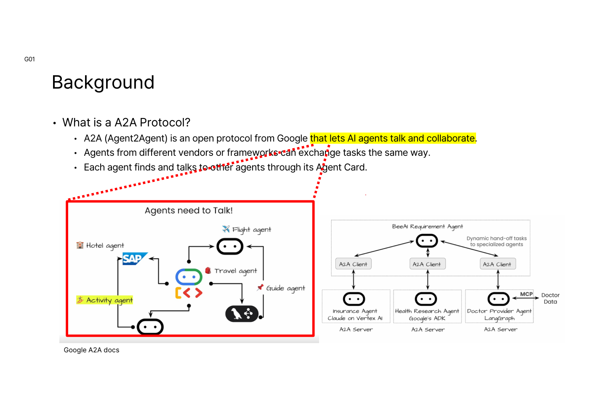
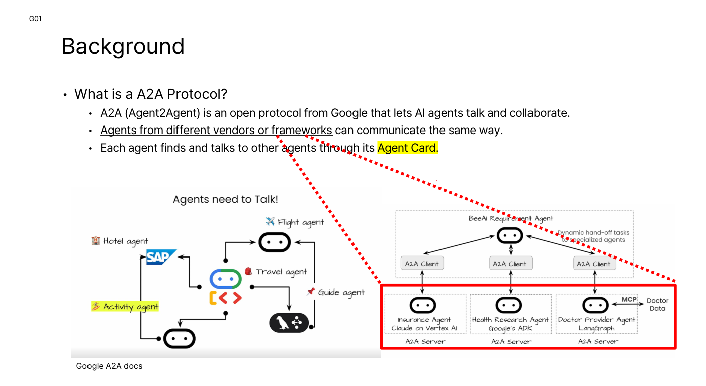
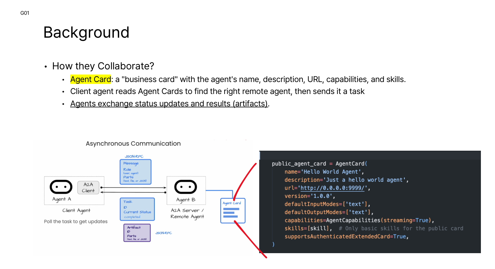
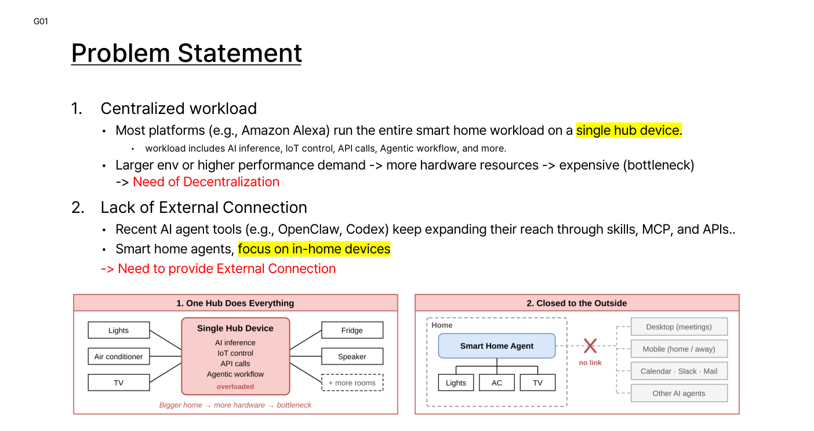
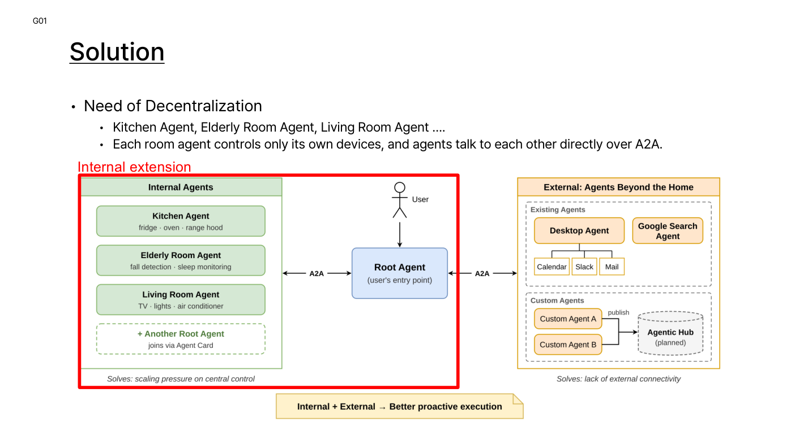
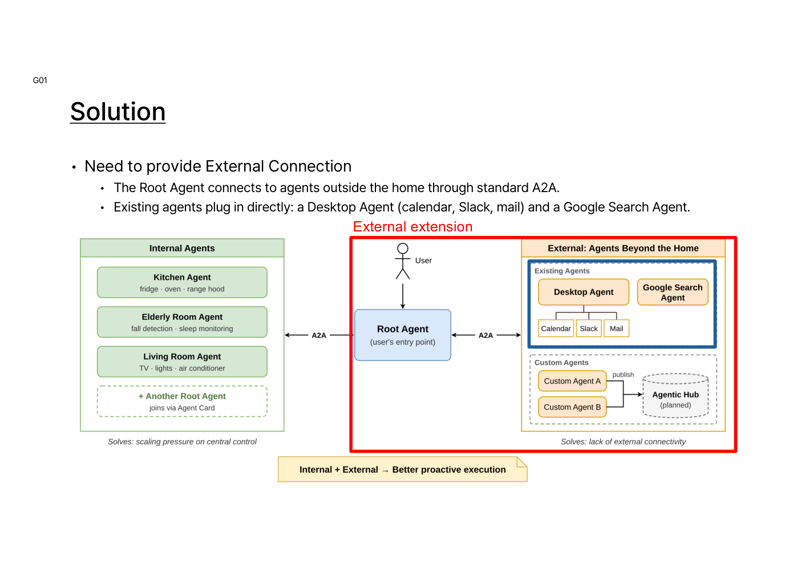
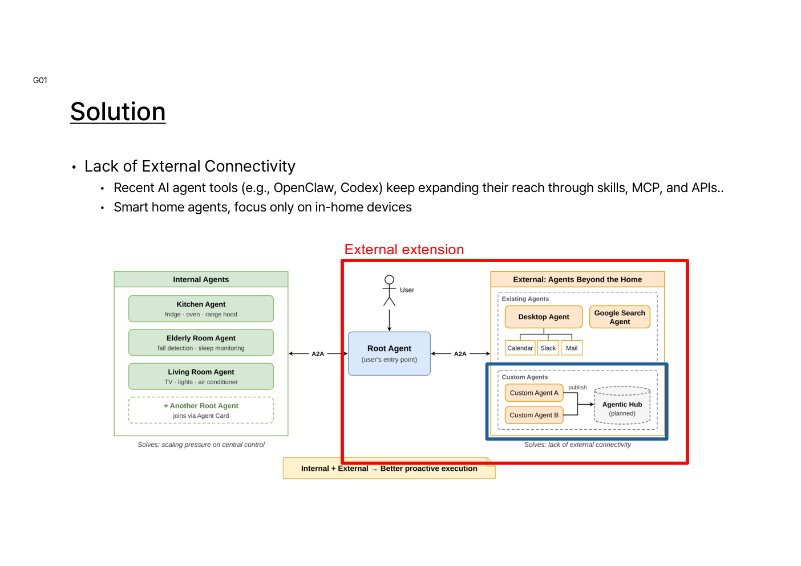
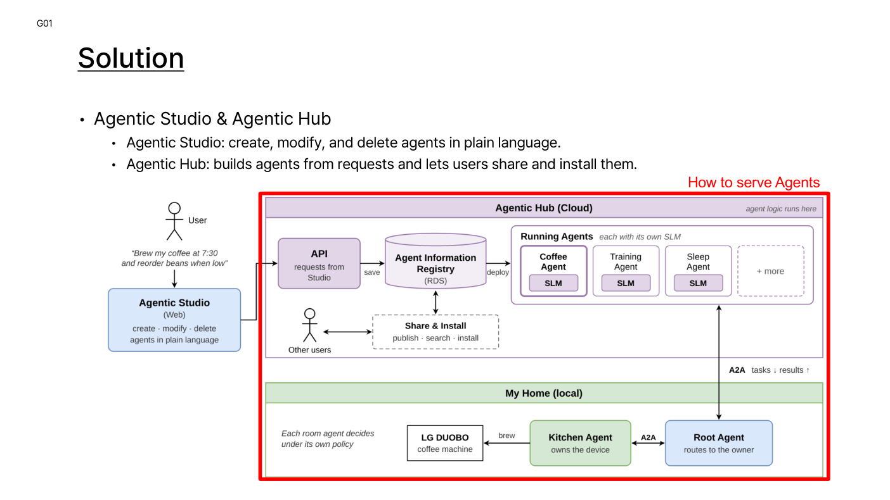
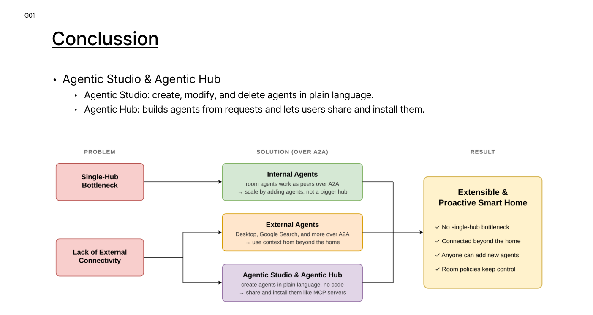
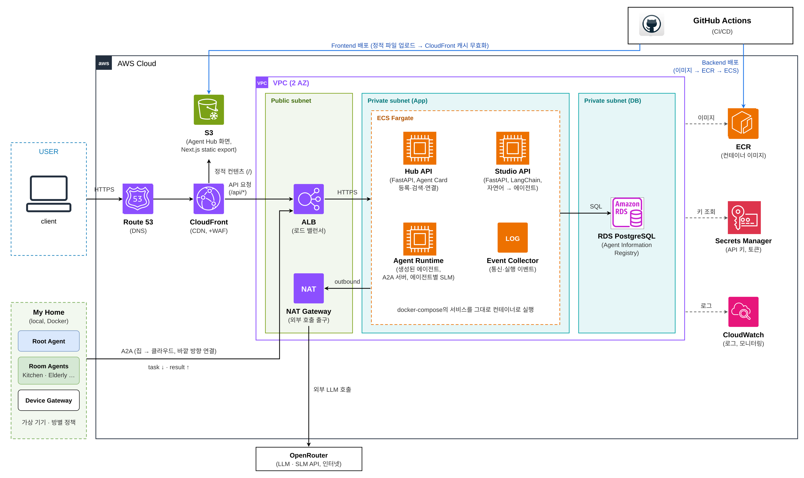

# SWE-Final — Extension of Smart Home: Internal & External Connectivity via A2A

**한국어** | [English](README.en.md)

**G01 | A2A-Lite** · 고라희, 신윤수, 홍예원 (한양대 CSE406 · LG전자 IC-PBL "Proactive Agentic Home")

Today’s smart homes run everything on one hub. We split it into small agents that talk over A2A.
- Inside the home: each room has its own agent for its own devices.
- Outside the home: the home connects to agents on your desktop and phone.
- Agentic Studio: describe an agent in plain words, and it is built for you.
- Agentic Hub: share, find, and install agents.

기획서: [plan.md](plan.md)

### 1. Problem Statement


스마트홈의 두 가지 문제를 정의한다.
- **Centralized workload:** Amazon Alexa 같은 플랫폼은 AI 추론, IoT 제어, API 호출, 에이전트 워크플로를 모두 허브 기기 하나에서 처리한다. 집이 커지거나 더 높은 성능이 필요하면 하드웨어가 더 필요하고, 허브가 비싸지며 병목이 된다(왼쪽 그림 One Hub Does Everything). → **분산이 필요하다.**
- **Lack of External Connection:** OpenClaw, Codex 같은 AI 에이전트 도구는 Skill·MCP·API로 연결을 계속 넓히는데, 스마트홈 에이전트는 집 안 기기에만 집중한다. 데스크톱(회의), 휴대폰(재실/외출), 캘린더·Slack·메일, 다른 AI 에이전트와 연결되지 않는다(오른쪽 그림 Closed to the Outside). → **집 밖과의 연결이 필요하다.**

### 2. Background: A2A Protocol



A2A(Agent2Agent)는 Google이 공개한 개방형 프로토콜로, AI 에이전트끼리 대화하고 협업하게 한다. 다른 회사나 프레임워크로 만든 에이전트도 같은 방식으로 작업을 주고받고, 각 에이전트는 **Agent Card**로 서로를 찾는다. 왼쪽 그림(Google A2A 문서)은 Travel 에이전트가 Flight·Hotel·Activity·Guide 에이전트에게 일을 나눠 맡기는 예다.



오른쪽 그림을 강조했다. Vertex AI 위의 Claude, Google ADK, LangGraph처럼 **서로 다른 프레임워크로 만든 에이전트**도 A2A Server로 열려 있으면 하나의 Client가 같은 방식으로 소통한다. 스마트홈 에이전트와 집 밖 에이전트를 잇는 데 A2A를 쓰는 이유다.

### 3. Background: 에이전트가 협업하는 방식



- **Agent Card:** 에이전트의 "명함". 이름, 설명, URL, capabilities, skills를 담는다(오른쪽 코드).
- Client 에이전트는 Agent Card를 읽고 알맞은 Remote 에이전트를 골라 작업(Task)을 보낸다.
- 에이전트들은 JSON-RPC로 상태 업데이트와 결과(Artifact)를 주고받는다. 오래 걸리는 작업은 Task를 조회해 진행 상황을 받는다.

### 4. Problem Statement (다시)



해결책으로 넘어가기 전에 두 문제를 다시 짚는다. 이어지는 Solution 슬라이드는 각각 **분산(Internal extension)**과 **집 밖 연결(External extension)**에 대한 답이다.

### 5. Solution: Internal extension



**분산에 대한 답.** Kitchen Agent(냉장고·오븐·후드), Elderly Room Agent(낙상 감지·수면 모니터링), Living Room Agent(TV·조명·에어컨)처럼 방마다 에이전트를 둔다. **각 방 에이전트는 자기 기기만 제어하고, 에이전트끼리는 A2A로 직접 대화한다.** 사용자의 입구인 Root Agent는 요청을 기기 주인에게 넘길 뿐이고, 새 방이나 다른 Root Agent도 Agent Card만 있으면 합류한다. 집이 커지면 더 큰 허브가 아니라 에이전트를 더한다.

레포에서는 `agents/`의 orchestrator(Root)와 room1·room2(방), [spec/ambient-a2a.md](spec/ambient-a2a.md)의 소유권·정책 규칙, 그리고 기기 주인을 한 번 더 확인하는 Device Gateway(`services/gateway`)가 이 부분이다.

### 6. Solution: External extension — 기존 에이전트



**집 밖 연결에 대한 답(1).** Root Agent는 표준 A2A로 집 밖 에이전트와 연결된다. 이미 있는 에이전트가 그대로 붙는다: 캘린더·Slack·메일을 보는 Desktop Agent, Google Search Agent. 예를 들어 Desktop Agent가 "회의 중"이라는 상태를 알려 주면 집이 조용한 모드로 바뀐다. 외부 에이전트에는 허용된 정보만 공개하고, 캘린더 제목이나 GPS 같은 원본 개인정보는 보내지 않는다.

레포에서는 `agents/externel/`의 desktop·smartphone 에이전트가 이 부분이다.

### 7. Solution: External extension — 사용자가 만든 에이전트



**집 밖 연결에 대한 답(2).** 사용자는 자기만의 Custom Agent를 만들어 **Agentic Hub**에 올린다(publish). GitHub의 MCP 서버처럼, 다른 사용자가 이 에이전트를 찾아 설치할 수 있다. 집 안(Internal)과 집 밖(External)이 함께 연결되면 사용자가 말하기 전에 집이 먼저 움직이는 선제적 실행(proactive execution)이 가능해진다.

### 8. Agentic Studio: 에이전트를 만드는 방법


사용자는 웹의 **Agentic Studio**에서 자연어로 에이전트를 만들고, 고치고, 지운다. 예를 들어 *"Brew my coffee at 7:30 and reorder beans when low"*라고 입력하면 Studio가 요청을 Agentic Hub의 API로 보낸다.

레포에서는 [services/studio](services/studio)가 이 부분이다. LLM(LangChain + OpenRouter)은 정해진 슬롯 폼만 채우고, 규칙은 플랫폼 기본 Skill에서 만든다. 권한 잠금 검사와 사용자 승인을 통과해야만 Hub에 등록된다.

### 9. Agentic Studio: 만들어진 에이전트의 Agent Card


Studio가 만든 Coffee Agent도 표준 A2A Agent Card를 갖는다. 이름, 설명("정해진 시간에 커피를 내리고, 원두가 떨어지면 채운다"), Hub 안의 URL, capabilities, skills가 들어 있어서 다른 에이전트가 이 카드만 보고 찾아와 작업을 보낼 수 있다.

### 10. Agentic Hub: 에이전트를 실행하는 방법



**Agentic Hub(Cloud)**는 Studio의 요청을 API로 받아 Agent Information Registry(RDS)에 저장하고, 에이전트를 배포해 실행한다(Coffee, Training, Sleep …, 각자 자기 SLM 사용). 다른 사용자는 **Share & Install**로 에이전트를 공개·검색·설치한다. Hub의 에이전트는 집(My Home)의 Root Agent에 A2A로 작업을 보내고, Root Agent는 커피 머신의 주인인 Kitchen Agent에게 넘긴다. Kitchen Agent가 자기 정책을 확인한 뒤 LG DUOBO 커피 머신을 작동한다. **각 방 에이전트는 자기 정책으로 결정한다.**

레포에서는 [services/agenthub](services/agenthub)(Registry는 Docker의 PostgreSQL, Agent Card로 등록·검색·연결, 기기 주인 한 명 규칙)와 [agent_hub_FE/](agent_hub_FE/)(Hub 화면)가 이 부분이다. 생성된 에이전트는 지금 OpenClaw로 실행하고, `STUDIO_RUNTIME`으로 Python 실행기로 바꿀 수 있다. 다른 사용자와의 공유·설치, 클라우드 배포, 에이전트별 SLM은 아직 계획 단계다([plan.md](plan.md#5-구현-범위)).

### 11. Conclusion



문제와 해결, 결과를 한 장으로 묶는다.

| 문제 | A2A 위의 해결 | 결과 |
|---|---|---|
| Single-Hub Bottleneck | **Internal Agents**: 방 에이전트가 A2A로 대등하게 일한다. 더 큰 허브가 아니라 에이전트를 더해 확장 | 허브 하나의 병목이 없다 |
| Lack of External Connectivity | **External Agents**: Desktop, Google Search 등을 A2A로 연결해 집 밖 맥락을 쓴다 | 집 밖과 연결된다 |
| Lack of External Connectivity | **Agentic Studio & Hub**: 코드 없이 자연어로 에이전트를 만들고, MCP 서버처럼 공유·설치한다 | 누구나 새 에이전트를 더할 수 있다 |

그리고 어떤 에이전트가 요청하든 **방 정책이 제어권을 지킨다.** 그 결과가 확장 가능하고 선제적인 스마트홈(Extensible & Proactive Smart Home)이다.

## 기술 스택

| 영역 | 기술 |
|---|---|
| 에이전트 통신 | A2A v1.0, Ambient-A2A 확장 ([spec/ambient-a2a.md](spec/ambient-a2a.md)) |
| 에이전트 | OpenClaw + TypeScript 플러그인 (`STUDIO_RUNTIME`으로 Python 실행기로 교체 가능) |
| 백엔드 | Python, FastAPI, Pydantic v2 |
| 에이전트 생성 (Studio) | LangChain structured output, OpenRouter |
| 저장소 | PostgreSQL (Hub·Studio·Collector, Docker / RDS), SQLite (테스트) |
| 화면 | Next.js (Agent Hub) |
| 실행·배포 | Docker Compose (로컬), AWS ECS Fargate (계획), GitHub Actions |
| 테스트 | pytest, vitest, `scripts/scenario.sh`, `scripts/test_hub_studio.sh` |

### 배포 구조



Agentic Hub를 AWS에 올리는 배포 계획이다. 지금 레포는 같은 서비스를 로컬 Docker Compose로 실행한다.
- **화면과 API 입구:** 사용자는 Route 53 → CloudFront(+WAF)로 들어온다. 정적 화면(`/`)은 S3의 Agent Hub 화면(Next.js static export)에서, API 요청(`/api/*`)은 ALB를 거쳐 서비스로 간다.
- **서비스 (ECS Fargate, private subnet):** Hub API, Studio API, Agent Runtime(생성된 에이전트의 A2A 서버, 에이전트별 SLM), Event Collector. `docker-compose.yml`의 서비스를 그대로 컨테이너로 실행한다.
- **데이터:** Agent Information Registry는 DB 전용 private subnet의 RDS PostgreSQL. API 키와 토큰은 Secrets Manager, 로그는 CloudWatch, 이미지는 ECR에 둔다.
- **밖으로 나가는 호출:** LLM·SLM 호출(OpenRouter)은 NAT Gateway를 거친다.
- **집(My Home, 로컬 Docker):** Root Agent, 방 에이전트, Device Gateway(가상 기기, 방별 정책)는 집에 남는다. 집에서 클라우드로 A2A 연결을 열고, 작업을 받아(task ↓) 결과를 돌려준다(result ↑).
- **CI/CD (GitHub Actions):** 화면은 S3 업로드 후 CloudFront 캐시를 무효화하고, 백엔드는 이미지를 ECR에 올려 ECS에 배포한다.

## 레포 구조

```
SWE-Final/
├── docker-compose.yml        # 전체 실행: docker compose up -d --build
├── plan.md                   # 기획서 (발표 자료 기준)
├── agents/                   # OpenClaw 에이전트 5개 + Ambient-A2A 플러그인 (TypeScript)
│   ├── ambient-a2a-plugin/   #   ACL·소유권·정책(core.ts), 수신·위임·규칙(agent.ts), Gateway 클라이언트(devices.ts)
│   ├── externel/             #   desktop, smartphone (집 밖 에이전트)
│   ├── internel/             #   orchestrator(Root), room1, room2 (집 안 에이전트)
│   ├── generated/            #   Studio가 만든 에이전트 (git에 올리지 않음)
│   └── Dockerfile            #   다섯 에이전트 + Studio 에이전트 실행기(scripts/launcher.mjs)를 한 컨테이너에서 실행
├── services/                 # Python (FastAPI)
│   ├── gateway/              #   Device Gateway: 가상 집의 기기 상태 + 주인 확인
│   ├── collector/            #   Event Collector: 모든 에이전트의 통신·실행 기록, 요청 흐름
│   ├── agenthub/             #   Agent Hub: 등록·검색·연결·토큰·기기 주인 (PostgreSQL)
│   ├── studio/               #   Agent Studio: 자연어 → 에이전트 (LangChain + OpenRouter), 하네스, 실행기 교체(runtime.py)
│   ├── config/               #   agents.yaml(호출자), devices.yaml(가상 기기), skills.yaml(기본 스킬)
│   └── contracts/            #   화면이 받는 메시지 형식 (JSON Schema)
├── agent_hub_FE/             # Agent Hub 화면 (Next.js): 검색·상세·연결·내 에이전트·Studio, /home 스마트홈 앱. 토큰은 서버 쪽 프록시에만
├── spec/                     # Ambient-A2A 확장 명세
├── scripts/                  # setup.sh, run_all.sh, scenario.sh, say.sh, logs.sh, test_hub_studio.sh, oc.sh, launcher.mjs
├── training/                 # EXAONE SFT/DPO 실험 (에이전트별 SLM의 근거)
└── docs/                     # 발표 자료, 실행 가이드, 인수인계, 아키텍처, 검증·성능 기록
```

| 문서 | 내용 |
|---|---|
| [docs/RUN.md](docs/RUN.md) | 설치부터 데모까지 |
| [docs/HANDOFF.md](docs/HANDOFF.md) | 프로젝트 맥락과 결정 |
| [docs/integration.md](docs/integration.md) | 에이전트와 Gateway·Collector 연동 |
| [docs/architecture-services.md](docs/architecture-services.md) | services 아키텍처 (영문) |
| [services/README.md](services/README.md) | Hub·Studio API와 하네스 |
| [docs/verification-report.md](docs/verification-report.md), [docs/performance.md](docs/performance.md), [docs/dpo-experiment.md](docs/dpo-experiment.md) | 검증 결과, 응답 속도, EXAONE 학습 실험 (기록) |

SWE26-01의 A2A-agents(루트), a2a-agentic-home(`services/`)를 커밋 기록째 합친 레포다. 2026-11-20에 Home Assistant, 예전 시뮬레이터 화면, Live Simulation Runner를 지우고 Docker Compose 하나로 실행하도록 정리했다.

## 에이전트

OpenClaw 에이전트 5개가 A2A v1.0에 **Ambient-A2A 확장**([spec/ambient-a2a.md](spec/ambient-a2a.md))을 얹어 서로 소통한다. 확장은 상태 공유·구독, 공간별 소유권, 정책 기반 협업을 정의한다.

| Agent | 발표의 역할 | 포트 | 공개 정보 / 소유 기기 |
|---|---|---|---|
| `externel/desktop` | External: Desktop Agent | 18800 | `meeting_app_active`, `pc_state` |
| `externel/smartphone` | External: 휴대폰 | 18920 | `presence` |
| `internel/orchestrator` | Root Agent (사용자 입구) | 19040 | 거실 조명, TV, TV 음소거 |
| `internel/room1` | Internal: 방 에이전트 (My Room) | 19160 | 내 방 조명, 조명 모드, 에어컨, 재실 |
| `internel/room2` | Internal: 방 에이전트 (수면 정책 방) | 19280 | 보호 방 조명, 에어컨, 수면 모드 |

```
desktop ──"회의 시작"──▶ orchestrator ──(요청자 ACL 확인)──▶ room1 (자기 규칙으로 승인/거절) ──▶ Device Gateway (주인 재확인)
   ▲                         │
   └──── context.query ──────┘   (Root가 external 정보를 조회. 허용된 필드만 반환)
```

LLM(OpenClaw)은 사용자 의도를 해석해 `ambient_*` tool을 호출하는 역할만 한다. 정책, 소유권, 만료 판단은 플러그인 코드가 결정적으로 처리하고, 기기는 Device Gateway가 주인을 한 번 더 확인한 뒤에만 움직인다. 실제 기기는 없고 Gateway가 가상 집(`services/config/devices.yaml`)을 들고 있다.

## 실행

```bash
scripts/setup.sh            # 최초 1회: .env를 만들고 토큰을 채운다. 그다음 .env에 OPENROUTER_API_KEY만 넣는다
docker compose up -d --build   # 또는 scripts/run_all.sh (다 뜰 때까지 기다리고 주소 출력)
```

| 이름 | 주소 |
|---|---|
| Agent Hub 화면 | http://127.0.0.1:3000 |
| 스마트홈 앱 (공간·기기·외부 연결) | http://127.0.0.1:3000/home |
| Agent Hub API · Studio API | http://127.0.0.1:8400/docs · http://127.0.0.1:8500/docs |
| Device Gateway · Event Collector | http://127.0.0.1:8100 · http://127.0.0.1:8200 (`DASHBOARD_TOKEN`) |
| 에이전트 | 127.0.0.1:18800 / 18920 / 19040 / 19160 / 19280 |

```bash
scripts/logs.sh                                  # A2A 이벤트 로그
scripts/say.sh desktop "나 회의 시작할게"           # 에이전트에 자연어 한 턴
scripts/scenario.sh [--llm] [--kill-home]        # 결정적 검증 (scripts/setup.sh --local 필요)
scripts/test_hub_studio.sh                       # Hub·Studio 26단계 확인
docker compose down                              # 종료
```

자세한 순서와 문제 해결은 [docs/RUN.md](docs/RUN.md).

## 검증 항목 (plan.md 5.3)
| 항목 | 시나리오 |
|---|---|
| 외부 상태 전달 | 구독 → `context.update` → room1 조명 회의 모드 |
| 허용되지 않은 조회 차단 | Root의 `pc_state` 조회 → `FIELD_NOT_ALLOWED`, 잘못된 토큰 → `UNAUTHORIZED` |
| 만료·역순 데이터 무시 | sequence 역행 또는 만료 → `STALE` |
| 자기 기기만 직접 제어 | room1이 거실 TV 제어 → `NOT_OWNER`, Root는 room 기기를 위임(`delegated_to`), Gateway도 남의 기기 명령을 403으로 막음 |
| 안전 정책 거절 | room2 수면 중 에어컨 끄기 → `SAFETY_POLICY` |
| Root 중단 시 독립 동작 | `--kill-home` |
| 집 전체 협업 | 전체 절전 → room1 실행, room2 일부 거절 → Root가 `PARTIAL`로 취합 |
| 신규 Agent 연결 | Hub는 기기 주인 중복 연결을 거절하고, 연결한 Studio 에이전트를 바로 실행. Root와 Gateway는 Hub의 지금 주인을 따른다 |
| 자연어 에이전트 생성 | Studio가 만든 에이전트는 권한 잠금 검사와 사용자 승인을 통과해야 Hub에 등록 |

## 알려진 한계
- 토큰은 에이전트당 하나이고 피어끼리 공유한다. 상호 신뢰하지 않는 환경이라면 쌍별 토큰이나 mTLS로 바꿔야 한다.
- 가상 집의 기기 상태는 Gateway 메모리에 있어서 Gateway를 다시 시작하면 처음 상태로 돌아간다.
- 구독 정보는 publisher 메모리에만 있다. external을 재시작하면 구독하던 쪽도 재시작해야 한다.
- OpenClaw gateway 하나가 메모리를 약 1GB 쓴다. Studio 에이전트를 여러 개 연결하려면 Docker 메모리를 늘려야 한다.
- 기본 에이전트 5개의 토큰과 주소는 여전히 `.env`·`agents/shared.json5`에 있다. Hub는 그 위에서 연결·주인을 정한다.
- 계정은 여럿이지만 집은 하나다. 다른 계정이 설치(연결)한 에이전트도 같은 가상 집의 기기를 움직인다. 회원가입은 약관·이메일 확인이 없는 데모 수준이다.
