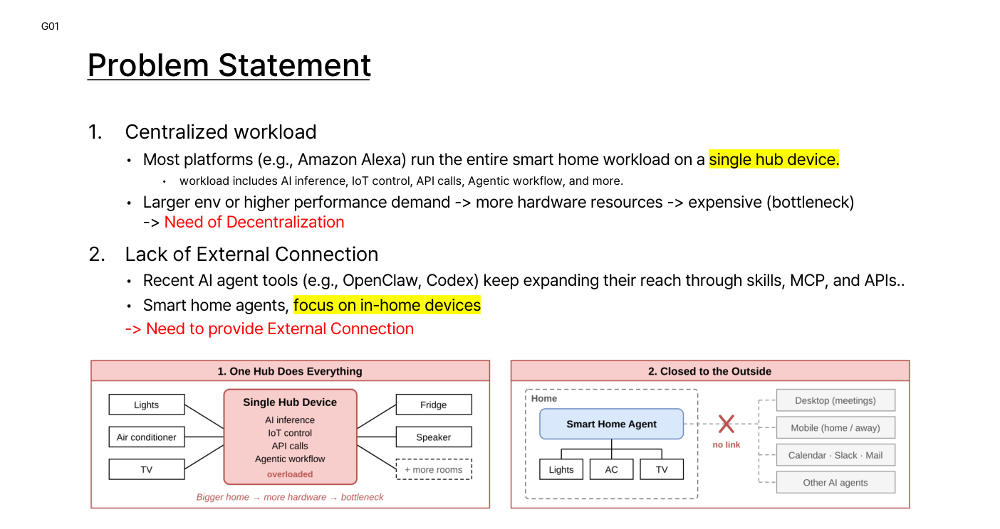
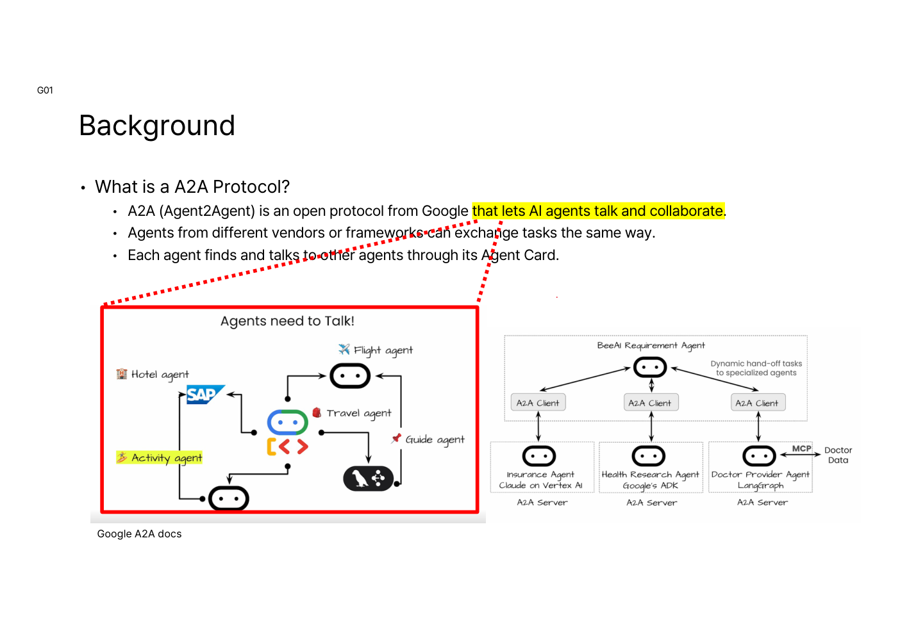
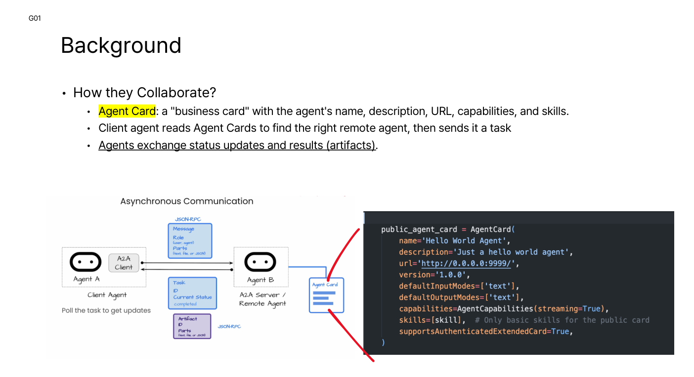
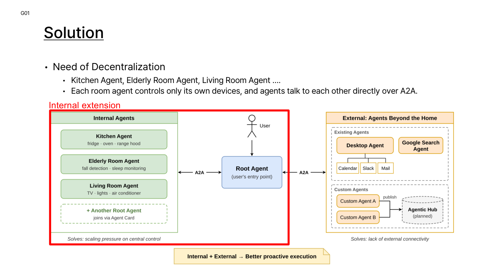
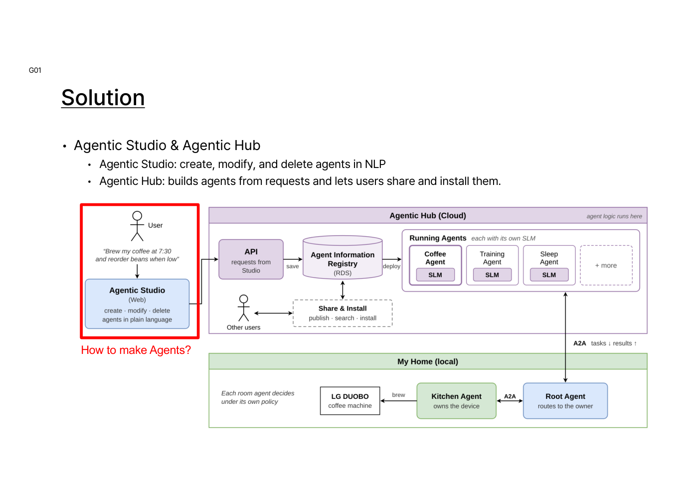
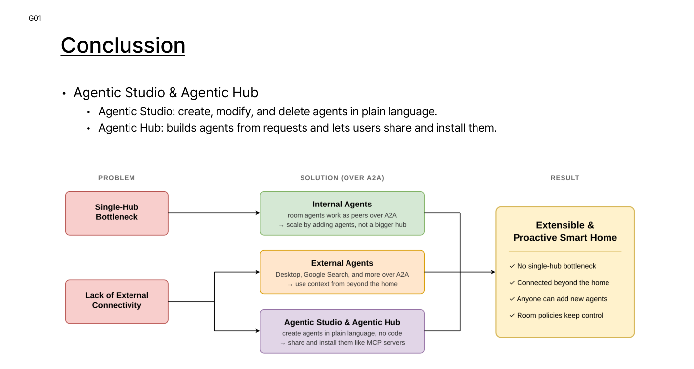
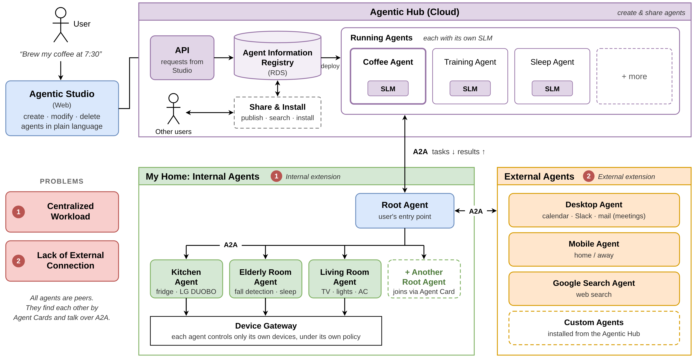
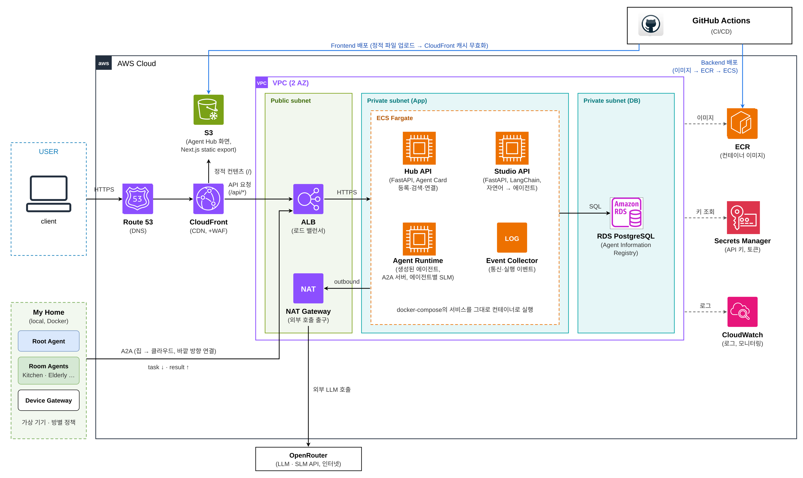

# 발표 자료

| 파일 | 내용 |
|---|---|
| [presentation.pdf](presentation.pdf) | 발표 슬라이드 14쪽 (영어, 2026-11-18 기획 단계) |
| `slide-NN.png` | PDF의 NN쪽을 그림으로 뽑은 것 |
| [overview.png](overview.png) | 발표 전체를 한 장으로 모은 그림 (루트 README의 첫 그림) |
| [structure.png](structure.png) | AWS 배포 계획 (구현하지 않음) |

슬라이드는 기획 단계에 만들어서 지금 레포와 다른 곳이 있다. 먼저 [슬라이드와 지금 레포가 다른 점](#슬라이드와-지금-레포가-다른-점)을 본다.

## 쪽별 구성

| 쪽 | 제목 | 내용 | 그림 |
|---|---|---|---|
| 1 | 표지 | 제목, 팀(G01 \| A2A-Lite), 이름 | — |
| 2 | Problem Statement | 문제 두 개: 허브 하나에 몰린 일, 집 밖과 단절 | [02](slide-02.png) |
| 3 | 표지 | 1쪽과 같다 | — |
| 4–5 | Background | A2A란 무엇인가. 4쪽은 왼쪽 그림, 5쪽은 오른쪽 그림을 강조한다 | [04](slide-04.png) · [05](slide-05.png) |
| 6 | Background | Agent Card와 에이전트가 협업하는 방식 | [06](slide-06.png) |
| 7 | Problem Statement | 2쪽과 같다. 해결로 넘어가기 전에 다시 보여 준다 | [07](slide-07.png) |
| 8–10 | Solution | 같은 그림에서 강조만 옮긴다. 8 집 안, 9 집 밖의 기존 에이전트, 10 사용자가 만든 에이전트 | [08](slide-08.png) · [09](slide-09.png) · [10](slide-10.png) |
| 11–13 | Solution | Agentic Studio & Hub. 11 만드는 법, 12 만들어진 에이전트의 Agent Card, 13 실행하는 법 | [11](slide-11.png) · [12](slide-12.png) · [13](slide-13.png) |
| 14 | Conclusion | 문제 → 해결 → 결과 | [14](slide-14.png) |

## 슬라이드 설명

### 문제 (2쪽, 7쪽)

- **Centralized workload (허브 하나에 몰린 일):** Amazon Alexa 같은 플랫폼은 AI 추론, IoT 제어, API 호출, 에이전트 워크플로를
  모두 허브 기기 하나에서 처리한다. 집이 커지거나 더 높은 성능이 필요하면 하드웨어가 더 필요하고, 허브가 비싸지며
  병목이 된다(왼쪽 그림 One Hub Does Everything). → **분산이 필요하다.**
- **Lack of External Connection (집 밖과 단절):** OpenClaw, Codex 같은 AI 에이전트 도구는 Skill·MCP·API로 연결을 계속
  넓히는데, 스마트홈 에이전트는 집 안 기기에만 집중한다. 데스크톱(회의), 휴대폰(재실/외출), 캘린더·Slack·메일,
  다른 AI 에이전트와 연결되지 않는다(오른쪽 그림 Closed to the Outside). → **집 밖과의 연결이 필요하다.**

### 배경: A2A (4–6쪽)

A2A(Agent2Agent)는 Google이 공개한 개방형 프로토콜로, AI 에이전트끼리 대화하고 협업하게 한다. 다른 회사나
프레임워크로 만든 에이전트도 같은 방식으로 작업을 주고받고, 각 에이전트는 **Agent Card**로 서로를 찾는다.
- 4쪽은 왼쪽 그림(Google A2A 문서)을 강조한다. Travel 에이전트가 Flight·Hotel·Activity·Guide 에이전트에게 일을 나눠 맡긴다.
- 5쪽은 오른쪽 그림을 강조한다. Vertex AI 위의 Claude, Google ADK, LangGraph처럼 **서로 다른 프레임워크로 만든 에이전트**도
  A2A 서버로 열려 있으면 하나의 클라이언트가 같은 방식으로 부른다. 스마트홈 에이전트와 집 밖 에이전트를 잇는 데
  A2A를 쓰는 이유다.

6쪽은 에이전트가 협업하는 방식이다.
- **Agent Card**는 에이전트의 "명함"이다. 이름, 설명, URL, capabilities, skills를 담는다(오른쪽 코드).
- 클라이언트 에이전트는 Agent Card를 읽고 알맞은 원격 에이전트를 골라 작업(Task)을 보낸다.
- 에이전트들은 JSON-RPC로 상태와 결과(Artifact)를 주고받는다. 오래 걸리는 작업은 Task를 조회해 진행 상황을 받는다.

### 해결: 집 안과 집 밖 (8–10쪽)

세 쪽 모두 같은 그림이고 강조만 옮겨 간다. 가운데 Root Agent가 사용자의 입구이고, 왼쪽이 집 안(Internal),
오른쪽이 집 밖(External) 에이전트다.
- **8쪽 Internal extension (분산에 대한 답):** Kitchen Agent(냉장고·오븐·후드), Elderly Room Agent(낙상 감지·수면 모니터링),
  Living Room Agent(TV·조명·에어컨)처럼 방마다 에이전트를 둔다. 각 방 에이전트는 자기 기기만 제어하고, 에이전트끼리는
  A2A로 직접 대화한다. Root Agent는 요청을 기기 주인에게 넘길 뿐이다. 새 방이나 다른 Root Agent도 Agent Card만 있으면
  합류한다. 집이 커지면 더 큰 허브가 아니라 에이전트를 더한다.
- **9쪽 External extension, 기존 에이전트 (집 밖 연결에 대한 답 1):** Root Agent는 표준 A2A로 집 밖 에이전트와 연결된다.
  이미 있는 에이전트가 그대로 붙는다. 캘린더·Slack·메일을 보는 Desktop Agent, Google Search Agent가 그 예다.
  외부 에이전트에는 허용된 정보만 공개하고, 캘린더 제목이나 GPS 같은 원본 개인정보는 보내지 않는다.
- **10쪽 External extension, 사용자가 만든 에이전트 (집 밖 연결에 대한 답 2):** 사용자는 자기만의 Custom Agent를 만들어
  Agentic Hub에 올린다(publish). GitHub의 MCP 서버처럼 다른 사용자가 이 에이전트를 찾아 설치한다.

아래 노란 상자 "Internal + External → Better proactive execution"은 집 안과 집 밖이 이어지면 사용자가 말하기 전에
집이 먼저 움직일 수 있다는 뜻이다. 예를 들어 PC에서 회의가 시작되면 내 방 조명이 알아서 회의 모드로 바뀐다.

### 해결: Agentic Studio & Agentic Hub (11–13쪽)

- **11쪽 How to make Agents?** 사용자는 웹의 Agentic Studio에서 평범한 말로 에이전트를 만들고, 고치고, 지운다.
  예를 들어 *"Brew my coffee at 7:30 and reorder beans when low"*라고 입력하면 Studio가 요청을 Agentic Hub의 API로 보낸다.
- **12쪽:** Studio가 만든 Coffee Agent도 표준 A2A Agent Card를 갖는다. 다른 에이전트는 이 카드만 보고 찾아와 작업을 보낸다.
- **13쪽 How to serve Agents:** Agentic Hub(Cloud)는 Studio의 요청을 API로 받아 Agent Information Registry(RDS)에 저장하고,
  에이전트를 배포해 실행한다(Coffee, Training, Sleep …). 다른 사용자는 Share & Install로 에이전트를 공개·검색·설치한다.
  Hub의 에이전트는 집(My Home)의 Root Agent에 A2A로 작업을 보내고, Root Agent는 커피 머신의 주인인 Kitchen Agent에게
  넘긴다. Kitchen Agent가 자기 정책을 확인한 뒤 LG DUOBO 커피 머신을 작동한다. **각 방 에이전트는 자기 정책으로 결정한다.**

### 결론 (14쪽)

| 문제 | A2A 위의 해결 | 결과 |
|---|---|---|
| Single-Hub Bottleneck | **Internal Agents**: 방 에이전트가 A2A로 대등하게 일한다. 더 큰 허브가 아니라 에이전트를 더해 확장한다 | 허브 하나의 병목이 없다 |
| Lack of External Connectivity | **External Agents**: Desktop, Google Search 등을 A2A로 연결해 집 밖 맥락을 쓴다 | 집 밖과 연결된다 |
| Lack of External Connectivity | **Agentic Studio & Hub**: 코드 없이 말로 에이전트를 만들고, MCP 서버처럼 공유·설치한다 | 누구나 새 에이전트를 더할 수 있다 |

어떤 에이전트가 요청하든 **방 정책이 제어권을 지킨다.** 그 결과가 확장 가능하고 선제적인 스마트홈
(Extensible & Proactive Smart Home)이다.

## 슬라이드와 지금 레포가 다른 점

| 슬라이드 | 지금 레포 |
|---|---|
| Agentic Studio, Agentic Hub | 코드와 문서에서는 Agent Studio(`services/studio`), Agent Hub(`services/agenthub`)다. 둘을 쓰는 화면 이름은 Agent Cloud(`web/apps/cloud`)다 |
| Kitchen · Elderly Room · Living Room Agent | 방 에이전트는 내 방(`room1`), 보호 방(`room2`), 주방(`kitchen`)이다. 거실 기기는 Root Agent(`root`)가 직접 맡는다. Elderly Room은 없다 |
| Desktop Agent(Calendar · Slack · Mail), Google Search Agent | 외부 에이전트는 PC(`desktop`: 회의 중인지, PC 상태)와 스마트폰(`smartphone`: 재실)이다. 실제 캘린더·Slack·메일 연동과 Google Search 에이전트는 없다 |
| Agentic Hub (planned) | 구현했다(로컬 Docker). 계정, 카탈로그, 공유, 별, 연결(설치), 기기 주인 관리 |
| "Agentic Hub: builds agents from requests" | 에이전트는 Studio가 만든다. LLM은 정해진 양식의 빈칸만 채우고, 사람이 승인하면 Hub에 등록된다. Hub는 등록·연결·실행을 맡는다 |
| Running Agents, each with its own SLM | 에이전트별 SLM 대신 Claude Haiku(OpenRouter)를 쓴다(2026-11-22 결정). EXAONE 학습 실험은 [기록](../dpo-experiment.md)으로만 남겼다 |
| Agent Card 코드(6, 12쪽) | A2A v0.3 예제 모양(`url`, `supportsAuthenticatedExtendedCard`)이다. 레포는 v1.0 카드(`supportedInterfaces`)를 쓰고, 맡은 공간·기기·공유 정보는 `skills[].tags`로 알린다 |
| Agent Information Registry (RDS) | 로컬 Docker의 PostgreSQL이다. 클라우드 배포는 계획만 있다 |

## 한 장 요약 그림

발표 전체(문제 두 개, 집 안·집 밖 에이전트, Studio와 Hub)를 한 장에 모은 그림이다. 루트 README의 첫 그림으로 쓴다.
슬라이드와 같은 기획 기준이라 위의 "다른 점"이 이 그림에도 해당한다.

## 배포 계획

Agent Hub를 AWS에 올리는 계획이다. **구현하지 않았다.** 지금은 같은 서비스를 로컬 Docker Compose로 실행한다.
- **화면과 API 입구:** 사용자는 Route 53 → CloudFront(+WAF)로 들어온다. 정적 화면(`/`)은 S3에서, API 요청(`/api/*`)은
  ALB를 거쳐 서비스로 간다.
- **서비스 (ECS Fargate, private subnet):** Hub API, Studio API, Agent Runtime(생성된 에이전트의 A2A 서버), Event Collector.
  `docker-compose.yml`의 서비스를 그대로 컨테이너로 실행한다.
- **데이터:** Agent Information Registry는 DB 전용 private subnet의 RDS PostgreSQL이다. API 키와 토큰은 Secrets Manager,
  로그는 CloudWatch, 이미지는 ECR에 둔다.
- **밖으로 나가는 호출:** LLM 호출(OpenRouter)은 NAT Gateway를 거친다.
- **집 (My Home, 로컬 Docker):** Root Agent, 방 에이전트, Device Gateway(가상 기기, 방별 정책)는 집에 남는다.
  집에서 클라우드로 A2A 연결을 열고, 작업을 받아(task ↓) 결과를 돌려준다(result ↑).
- **CI/CD (GitHub Actions):** 화면은 S3에 올린 뒤 CloudFront 캐시를 무효화하고, 백엔드는 이미지를 ECR에 올려 ECS에 배포한다.

그림이 지금 코드와 맞지 않는 곳:
- 화면을 S3 정적 파일(Next.js static export)로 그렸지만, 지금 화면(`web/`)은 서버 쪽 프록시와 로그인 쿠키 때문에
  Next.js 서버(`output: "standalone"`)가 있어야 한다. 배포하려면 화면도 ECS 서비스로 올려야 한다.
- 스마트홈 앱(`web/apps/home`)이 그림에 없다.
- Agent Runtime의 "에이전트별 SLM"은 Claude Haiku(OpenRouter) 호출로 바뀌었다.
